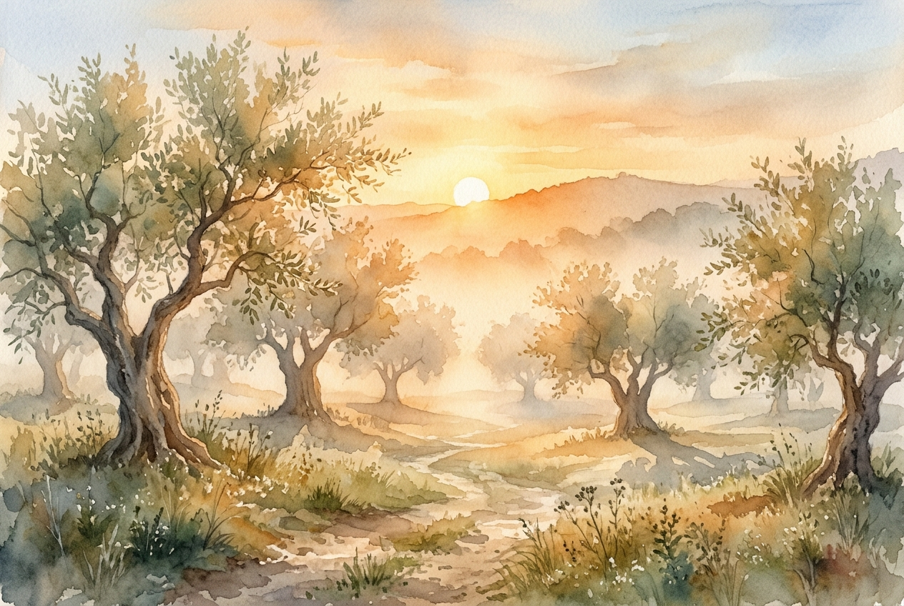

# Leitura Diária: John 3:16-21

*10 de novembro de 2026*

> *(Image: A warm, golden sunrise gently illuminating a misty, ancient olive grove, casting long soft shadows that fade into the morning light.)*

## A Leitura (PT-NVI)

**John 3:16-21**

> 16 "Porque Deus tanto amou o mundo que deu o seu Filho Unigênito, para que todo o que nele crer não pereça, mas tenha a vida eterna. 17 Pois Deus enviou o seu Filho ao mundo, não para condenar o mundo, mas para que este fosse salvo por meio dele. 18 Quem nele crê não é condenado, mas quem não crê já está condenado, por não crer no nome do Filho Unigênito de Deus. 19 Este é o julgamento: a luz veio ao mundo, mas os homens amaram as trevas, e não a luz, porque as suas obras eram más. 20 Quem pratica o mal odeia a luz e não se aproxima da luz, temendo que as suas obras sejam manifestas. 21 Mas quem pratica a verdade vem para a luz, para que se veja claramente que as suas obras são realizadas por intermédio de Deus".

## A História

No primeiro século, o manto da noite oferecia um refúgio seguro para aqueles que tinham medo de serem vistos. Foi exatamente sob essa escuridão que um líder religioso buscou uma conversa silenciosa, longe dos olhares críticos de seus pares. A cultura da época estava imersa em um profundo medo da retribuição divina, onde doenças e dificuldades eram frequentemente vistas como punições diretas dos céus. Imaginar uma força divina chegando não com um martelo de juiz, mas com uma missão de resgate, era um desvio radical da norma. A crença predominante era que a exposição significava condenação e vergonha. No entanto, esse diálogo noturno introduziu uma realidade completamente diferente, pintando o retrato de um criador cuja postura principal em relação à humanidade é um amor profundo e doador.

## Aplicação para Hoje

Muitas vezes carregamos o fardo exaustivo de esconder nossas falhas, convencidos de que, se formos verdadeiramente vistos, seremos rejeitados. É muito fácil recuar para as sombras quando nos sentimos inadequados, temendo o brilho duro do julgamento. Mas a luz divina descrita aqui não é um holofote policial destinado a nos interrogar ou envergonhar. Em vez disso, é como o sol da manhã rompendo uma noite fria, oferecendo calor e um lugar seguro para finalmente sermos nós mesmos. Quando paramos de nos esconder e damos um passo em direção a essa luz, percebemos que não somos recebidos com condenação, mas com braços abertos. Podemos abaixar a pesada armadura do fingimento e nos permitir ser amados exatamente como somos. Caminhar para a luz torna-se um convite para um alívio e cura profundos.

---

*Citações bíblicas extraídas da Nova Versão Internacional (NVI), © 1993, 2000 por Biblica, Inc. Usado com permissão.*
