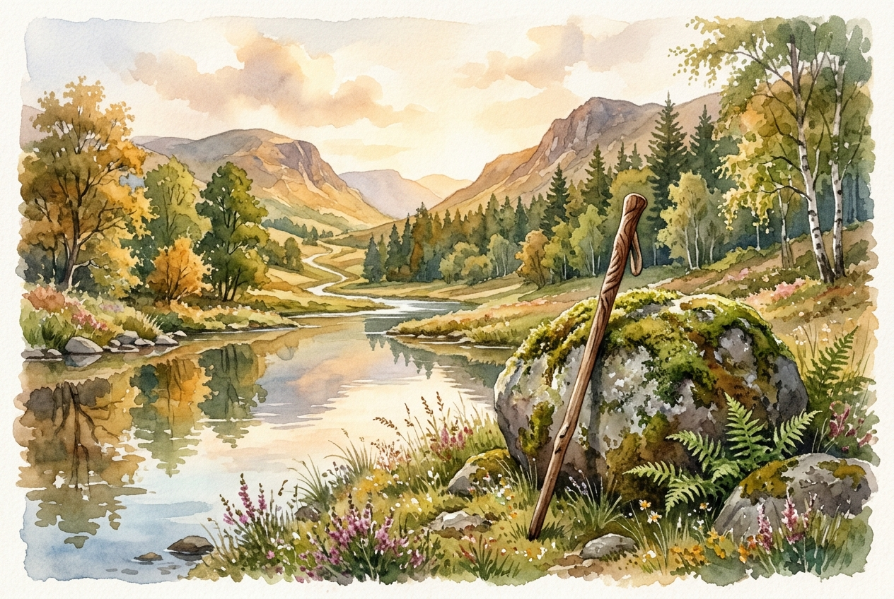

# Daily Reading: Psalm 23

*November 12, 2026*

> *(Image: A solitary wooden walking stick resting against a mossy stone near a calm, reflective stream in a sunlit valley.)*

## The Reading (NLT)

**Psalm 23**

> 1 The Lord is my shepherd; I have all that I need. 2 He lets me rest in green meadows; he leads me beside peaceful streams. 3 He renews my strength. He guides me along right paths, bringing honor to his name. 4 Even when I walk through the darkest valley, I will not be afraid, for you are close beside me. Your rod and your staff protect and comfort me. 5 You prepare a feast for me in the presence of my enemies. You honor me by anointing my head with oil. My cup overflows with blessings. 6 Surely your goodness and unfailing love will pursue me all the days of my life, and I will live in the house of the Lord forever.

## The Story

In the ancient Near East, a shepherd's work was relentless and intimate. They did not herd their flocks from behind with dogs, but led them from the front, calling out so the animals could follow a trusted voice. The landscape of ancient Judea was rugged and arid, making the search for safe water and grazing land a matter of survival. The poet draws on this lived reality to describe a relationship defined by careful attention. Halfway through the song, the perspective shifts from talking about a guide to speaking directly to a protector. The imagery moves from the open fields into a dark ravine, and finally to an abundant banquet table. It is a beautiful journey from vulnerability to absolute security.

## Application for Today

We often spend our days rushing from one obligation to the next, treating rest as a luxury rather than a necessity. Yet this ancient song insists that true restoration is a foundational part of how we are cared for. When we face periods of deep uncertainty or grief, the promise is not that the dark valleys will be entirely avoided. Instead, the assurance is that we will never have to walk through them alone. The presence we rely on is equipped to defend, comfort, and provide even when circumstances seem hostile. We can pause today and trust that goodness is actively pursuing us.

---

*Scripture quotations are taken from the Holy Bible, New Living Translation, copyright © 1996, 2004, 2015 by Tyndale House Foundation. Used by permission of Tyndale House Publishers.*
