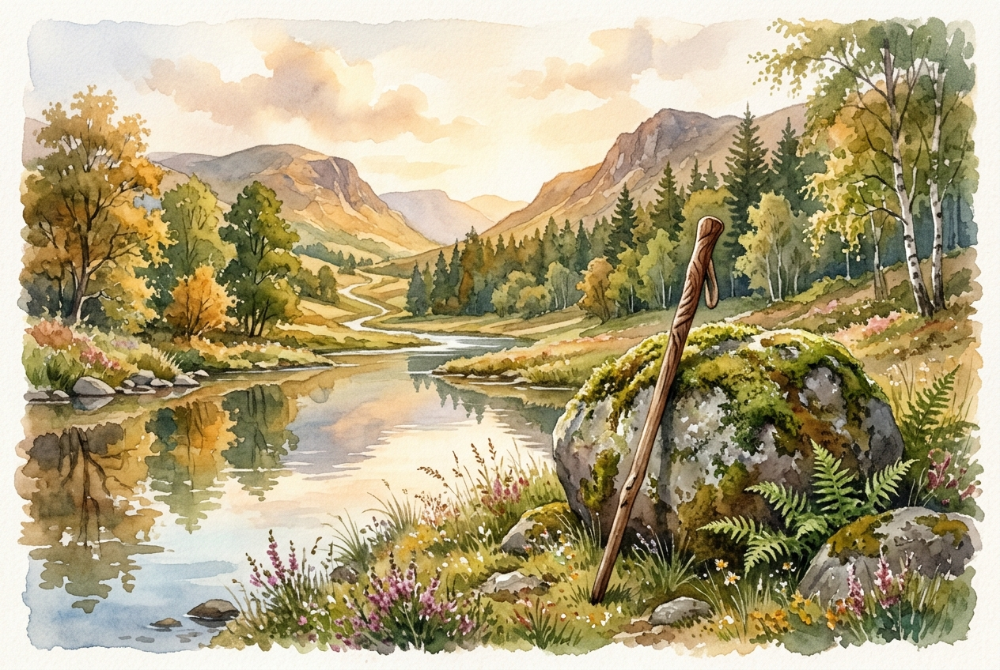

# Leitura Diária: Psalm 23

*12 de novembro de 2026*

> *(Image: A solitary wooden walking stick resting against a mossy stone near a calm, reflective stream in a sunlit valley.)*

## A Leitura (PT-NVI)

**Psalm 23**

> 1 O Senhor é o meu pastor; de nada terei falta. 2 Em verdes pastagens me faz repousar e me conduz a águas tranqüilas; 3 restaura-me o vigor. Guia-me nas veredas da justiça por amor do seu nome. 4 Mesmo quando eu andar por um vale de trevas e morte, não temerei perigo algum, pois tu estás comigo; a tua vara e o teu cajado me protegem. 5 Preparas um banquete para mim à vista dos meus inimigos. Tu me honras, ungindo a minha cabeça com óleo e fazendo transbordar o meu cálice. 6 Sei que a bondade e a fidelidade me acompanharão todos os dias da minha vida, e voltarei à casa do Senhor enquanto eu viver.

## A História

No antigo Oriente Médio, o trabalho de um pastor era constante e profundamente pessoal. Eles não empurravam seus rebanhos por trás, mas caminhavam à frente, usando a própria voz para guiar os animais em segurança. A paisagem da antiga Judeia era árida e cheia de perigos, tornando a busca por água e alimento uma questão de sobrevivência diária. O poeta utiliza essa realidade vivida para descrever um relacionamento marcado por uma atenção cuidadosa. Na metade da canção, a perspectiva muda de falar sobre um guia para falar diretamente com um protetor. A imagem sai dos campos abertos, passa por um desfiladeiro escuro e termina em uma mesa de banquete. É uma jornada que vai da vulnerabilidade à segurança absoluta.

## Aplicação para Hoje

Muitas vezes passamos nossos dias correndo de uma obrigação para outra, tratando o descanso como um luxo em vez de uma necessidade. No entanto, este antigo poema insiste que a verdadeira restauração é uma parte fundamental de como somos cuidados. Quando enfrentamos períodos de profunda incerteza ou luto, a promessa não é que os vales escuros serão totalmente evitados. Em vez disso, a garantia é que nunca teremos que caminhar por eles sozinhos. A presença na qual confiamos está equipada para defender, consolar e prover, mesmo quando as circunstâncias parecem hostis. Podemos fazer uma pausa hoje e confiar que a bondade está nos acompanhando ativamente.

---

*Citações bíblicas extraídas da Nova Versão Internacional (NVI), © 1993, 2000 por Biblica, Inc. Usado com permissão.*
