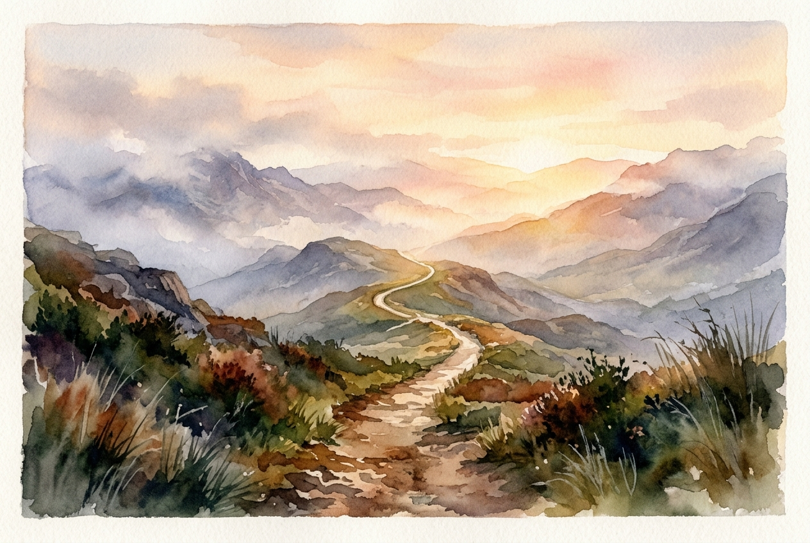

# Daily Reading: Hebrews 12:1-3

*November 12, 2026*

> *(Image: A narrow, well-worn path winds through a rugged, misty mountain landscape, bathed in the warm, guiding light of a breaking dawn.)*

## The Reading (NLT)

**Hebrews 12:1-3**

> 1 Therefore, since we are surrounded by such a huge crowd of witnesses to the life of faith, let us strip off every weight that slows us down, especially the sin that so easily trips us up. And let us run with endurance the race God has set before us. 2 We do this by keeping our eyes on Jesus, the champion who initiates and perfects our faith. Because of the joy awaiting him, he endured the cross, disregarding its shame. Now he is seated in the place of honor beside God's throne. 3 Think of all the hostility he endured from sinful people; then you won't become weary and give up.

## The Story

The author draws on the vivid imagery of a Greco-Roman athletic festival. In these ancient stadiums, runners competed under the watchful eyes of thousands of spectators. The text connects this cultural touchstone to the long lineage of faithful ancestors just recounted in the previous chapter. These ancestors form a vast, cheering crowd, testifying that the path of faith can actually be finished. Yet the ultimate focus is not on the crowd, but on the one who blazed the trail. Jesus is presented as the supreme athlete who already completed the grueling course, absorbing immense hostility and shame to reach the joy at the finish line.

## Application for Today

Life often feels like a marathon over impossibly rugged terrain, leaving us exhausted and ready to quit. We accumulate so much excess baggage, from our own recurring missteps to the heavy burdens of daily survival. To maintain our momentum, we have to deliberately shed these distractions and shift our gaze forward. We are not wandering blindly into the unknown. We are following a pioneer who has already navigated the deepest valleys of human suffering and rejection. Anchoring our attention on his resilience provides the steady rhythm we need to keep moving, step by step.

---

*Scripture quotations are taken from the Holy Bible, New Living Translation, copyright © 1996, 2004, 2015 by Tyndale House Foundation. Used by permission of Tyndale House Publishers.*
