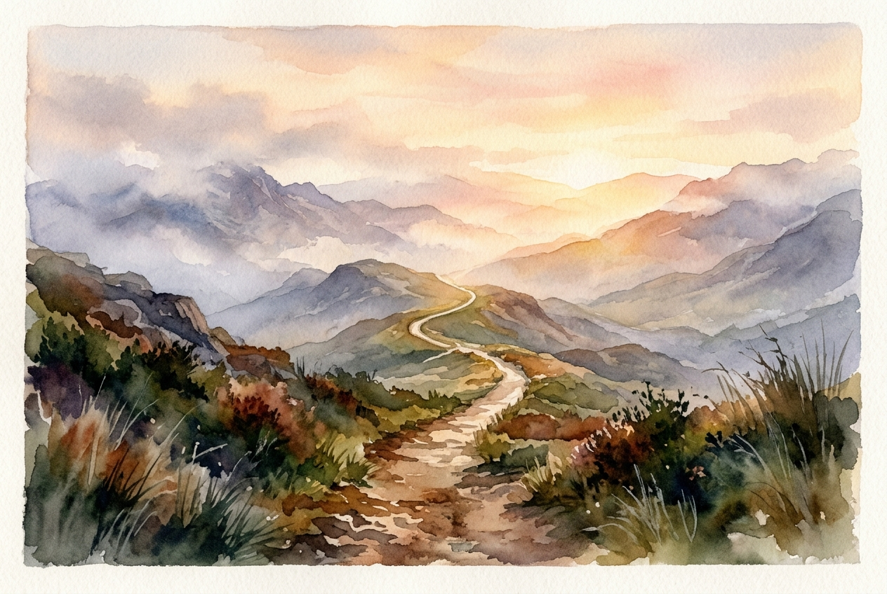

# Leitura Diária: Hebrews 12:1-3

*12 de novembro de 2026*

> *(Image: A narrow, well-worn path winds through a rugged, misty mountain landscape, bathed in the warm, guiding light of a breaking dawn.)*

## A Leitura (PT-NVI)

**Hebrews 12:1-3**

> 1 Portanto, também nós, uma vez que estamos rodeados por tão grande nuvem de testemunhas, livremo-nos de tudo o que nos atrapalha e do pecado que nos envolve, e corramos com perseverança a corrida que nos é proposta, 2 tendo os olhos fitos em Jesus, autor e consumador da nossa fé. Ele, pela alegria que lhe fora proposta, suportou a cruz, desprezando a vergonha, e assentou-se à direita do trono de Deus. 3 Pensem bem naquele que suportou tal oposição dos pecadores contra si mesmo, para que vocês não se cansem nem se desanimem.

## A História

O autor utiliza a imagem vívida de um festival atlético greco-romano. Nesses antigos estádios, os corredores competiam sob os olhares atentos de milhares de espectadores. O texto conecta essa referência cultural à longa linhagem de antepassados fiéis descrita no capítulo anterior. Esses ancestrais formam uma imensa multidão que torce por nós, testemunhando que é possível concluir a jornada da fé. No entanto, o foco principal não está na arquibancada, mas naquele que abriu o caminho. Jesus é apresentado como o atleta supremo que já completou o percurso exaustivo, absorvendo imensa hostilidade e vergonha para alcançar a alegria na linha de chegada.

## Aplicação para Hoje

A vida muitas vezes parece uma maratona em um terreno incrivelmente acidentado, deixando-nos exaustos e prontos para desistir. Acumulamos muita bagagem em excesso, desde nossos próprios tropeços recorrentes até os fardos pesados da sobrevivência diária. Para manter o ritmo, precisamos abandonar deliberadamente essas distrações e direcionar nosso olhar para a frente. Não estamos vagando às cegas rumo ao desconhecido. Seguimos um pioneiro que já atravessou os vales mais profundos do sofrimento e da rejeição humana. Ancorar nossa atenção em sua resiliência nos dá o ritmo constante de que precisamos para continuar avançando, passo a passo.

---

*Citações bíblicas extraídas da Nova Versão Internacional (NVI), © 1993, 2000 por Biblica, Inc. Usado com permissão.*
