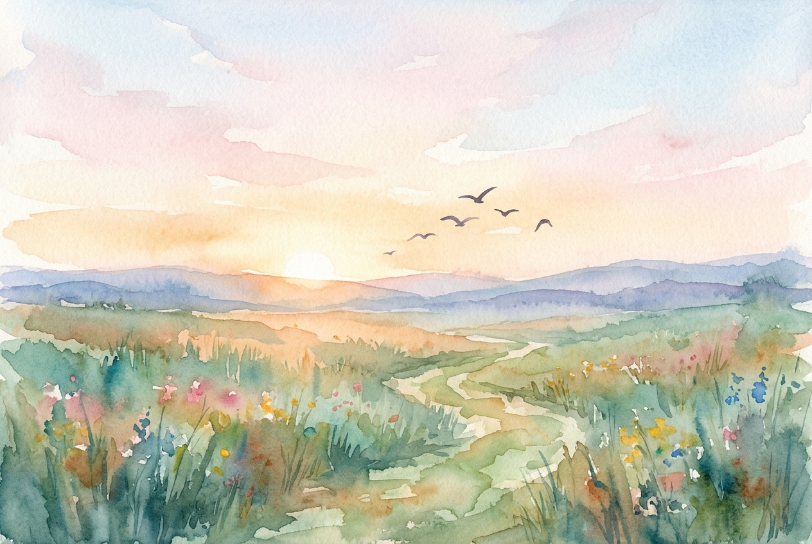

# Daily Reading: Matthew 6:25-34

*November 13, 2026*

> *(Image: A gentle sunrise illuminating a quiet meadow filled with wildflowers, with a few birds in flight against the soft morning sky.)*

## The Reading (NLT)

**Matthew 6:25-34**

> 25 That is why I tell you not to worry about everyday life whether you have enough food and drink, or enough clothes to wear. Isn't life more than food, and your body more than clothing? 26 Look at the birds. They don't plant or harvest or store food in barns, for your heavenly Father feeds them. And aren't you far more valuable to him than they are? 27 Can all your worries add a single moment to your life? 28 And why worry about your clothing? Look at the lilies of the field and how they grow. They don't work or make their clothing, 29 yet Solomon in all his glory was not dressed as beautifully as they are. 30 And if God cares so wonderfully for wildflowers that are here today and thrown into the fire tomorrow, he will certainly care for you. Why do you have so little faith? 31 So don't worry about these things, saying, ‘What will we eat? What will we drink? What will we wear?' 32 These things dominate the thoughts of unbelievers, but your heavenly Father already knows all your needs. 33 Seek the Kingdom of God above all else, and live righteously, and he will give you everything you need. 34 So don't worry about tomorrow, for tomorrow will bring its own worries. Today's trouble is enough for today.

## The Story

The original audience for this teaching was not composed of wealthy individuals with abstract anxieties, but subsistence farmers and day laborers living under occupation. Their fears about daily survival were immediate and grounded in harsh realities. In this setting, the teaching points to the surrounding ecosystem as tangible evidence of divine care. It contrasts the frantic accumulation driven by fear with the quiet, inherent rhythm of creation. The invitation is to shift focus from perceived scarcity to the steady reality of a sustaining Creator.

## Application for Today

Modern anxiety often pulls our minds into a future that has not yet arrived. We spend vast amounts of energy trying to secure our lives against every possible vulnerability and unknown outcome. Yet, this mental time-travel rarely solves our problems; it only exhausts our spirits before the actual work begins. Trusting the Divine does not mean ignoring practical responsibilities, but rather refusing to let fear become our primary motivation. By anchoring ourselves in the present moment and prioritizing a life of justice, we find the strength required for the tasks at hand. We can release our grip on the future and fully inhabit the grace given for today.

---

*Scripture quotations are taken from the Holy Bible, New Living Translation, copyright © 1996, 2004, 2015 by Tyndale House Foundation. Used by permission of Tyndale House Publishers.*
