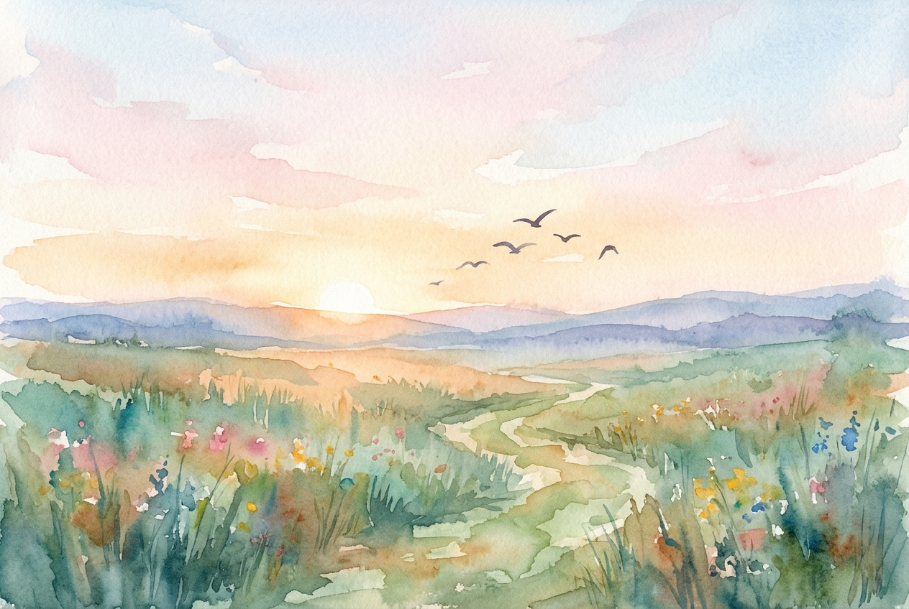

# Leitura Diária: Matthew 6:25-34

*13 de novembro de 2026*

> *(Image: A gentle sunrise illuminating a quiet meadow filled with wildflowers, with a few birds in flight against the soft morning sky.)*

## A Leitura (PT-NVI)

**Matthew 6:25-34**

> 25 "Portanto eu lhes digo: não se preocupem com suas próprias vidas, quanto ao que comer ou beber; nem com seus próprios corpos, quanto ao que vestir. Não é a vida mais importante do que a comida, e o corpo mais importante do que a roupa? 26 Observem as aves do céu: não semeiam nem colhem nem armazenam em celeiros; contudo, o Pai celestial as alimenta. Não têm vocês muito mais valor do que elas? 27 Quem de vocês, por mais que se preocupe, pode acrescentar uma hora que seja à sua vida? 28 "Por que vocês se preocupam com roupas? Vejam como crescem os lírios do campo. Eles não trabalham nem tecem. 29 Contudo, eu lhes digo que nem Salomão, em todo o seu esplendor, vestiu-se como um deles. 30 Se Deus veste assim a erva do campo, que hoje existe e amanhã é lançada ao fogo, não vestirá muito mais a vocês, homens de pequena fé? 31 Portanto, não se preocupem, dizendo: ‘Que vamos comer? ’ ou ‘que vamos beber? ’ ou ‘que vamos vestir? ’ 32 Pois os pagãos é que correm atrás dessas coisas; mas o Pai celestial sabe que vocês precisam delas. 33 Busquem, pois, em primeiro lugar o Reino de Deus e a sua justiça, e todas essas coisas lhes serão acrescentadas. 34 Portanto, não se preocupem com o amanhã, pois o amanhã se preocupará consigo mesmo. Basta a cada dia o seu próprio mal".

## A História

O público original deste ensinamento não era formado por pessoas ricas com ansiedades abstratas, mas por trabalhadores braçais e agricultores de subsistência vivendo sob ocupação. Seus medos sobre a sobrevivência diária eram imediatos e baseados em realidades duras. Nesse cenário, o mestre aponta para o ecossistema ao redor como uma evidência tangível do cuidado divino. O texto contrasta o acúmulo frenético impulsionado pelo medo com o ritmo silencioso e inerente da criação. O convite é para mudar o foco da escassez percebida para a realidade constante de um Criador que sustenta a vida.

## Aplicação para Hoje

A ansiedade moderna frequentemente arrasta nossas mentes para um futuro que ainda não chegou. Gastamos uma quantidade imensa de energia tentando proteger nossas vidas contra todas as vulnerabilidades e resultados desconhecidos. No entanto, essa viagem mental no tempo raramente resolve nossos problemas; ela apenas esgota nosso espírito antes mesmo de o trabalho real começar. Confiar no Divino não significa ignorar responsabilidades práticas, mas sim recusar que o medo se torne nossa motivação principal. Ao nos ancorarmos no momento presente e priorizarmos uma vida de justiça, encontramos a força necessária para as tarefas atuais. Podemos soltar as rédeas do futuro e viver plenamente a graça concedida para hoje.

---

*Citações bíblicas extraídas da Nova Versão Internacional (NVI), © 1993, 2000 por Biblica, Inc. Usado com permissão.*
