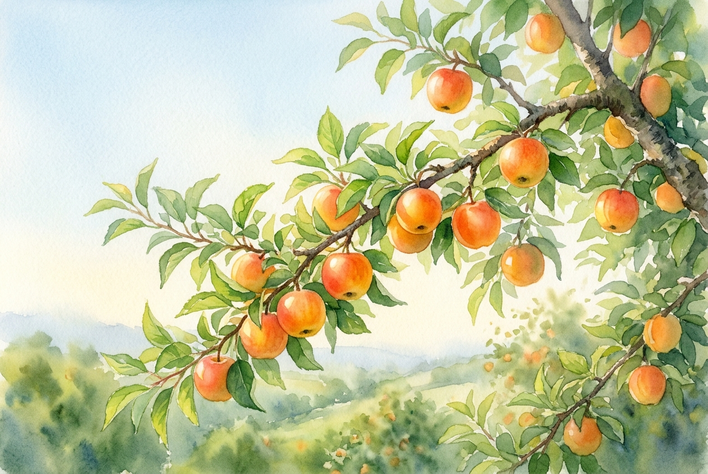

# Daily Reading: Galatians 5:22-26

*November 14, 2026*

> *(Image: A close-up of a vibrant, healthy orchard tree branch bearing ripe fruit, bathed in soft, warm morning sunlight against a clear sky.)*

## The Reading (NLT)

**Galatians 5:22-26**

> 22 But the Holy Spirit produces this kind of fruit in our lives: love, joy, peace, patience, kindness, goodness, faithfulness, 23 gentleness, and self-control. There is no law against these things! 24 Those who belong to Christ Jesus have nailed the passions and desires of their sinful nature to his cross and crucified them there. 25 Since we are living by the Spirit, let us follow the Spirit's leading in every part of our lives. 26 Let us not become conceited, or provoke one another, or be jealous of one another.

## The Story

When Paul writes to the early communities in Galatia, they are caught in a bitter tug-of-war. Factions are arguing over the necessity of strict religious codes versus absolute freedom. Paul reframes the entire debate by pointing them toward an organic metaphor of growth. He contrasts the destructive, divisive impulses of human nature with the natural yield of a life rooted in the divine. Instead of a checklist of rules to follow, he presents a singular, unified harvest that emerges from within. This transformation requires leaving behind old, ego-driven desires and learning to walk in a completely new cadence.

## Application for Today

We often treat spiritual growth as a series of disconnected goals, trying to force ourselves to be more patient one day and more kind the next. Yet this passage reminds us that genuine character is grown, not manufactured. When we align our daily habits with the divine presence, these virtues naturally emerge together as a cohesive whole. It is an invitation to stop striving for perfection through sheer willpower. Instead, we are called to stay closely connected to the source of life, allowing that relationship to reshape our reactions. As we abandon our need to compete or compare, we find ourselves naturally bearing what is good, gentle, and true.

---

*Scripture quotations are taken from the Holy Bible, New Living Translation, copyright © 1996, 2004, 2015 by Tyndale House Foundation. Used by permission of Tyndale House Publishers.*
