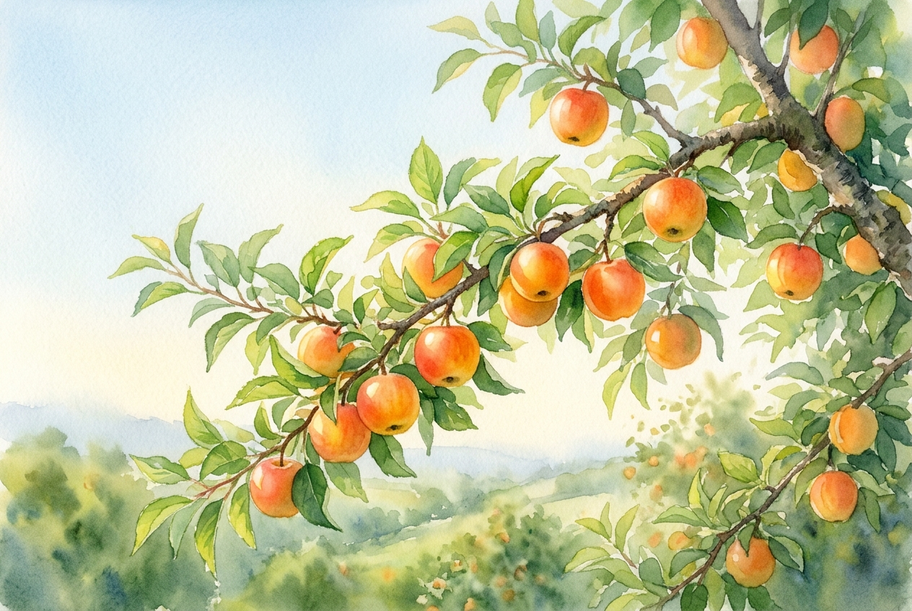

# Leitura Diária: Galatians 5:22-26

*14 de novembro de 2026*

> *(Image: A close-up of a vibrant, healthy orchard tree branch bearing ripe fruit, bathed in soft, warm morning sunlight against a clear sky.)*

## A Leitura (PT-NVI)

**Galatians 5:22-26**

> 22 Mas o fruto do Espírito é amor, alegria, paz, paciência, amabilidade, bondade, fidelidade, 23 mansidão e domínio próprio. Contra essas coisas não há lei. 24 Os que pertencem a Cristo Jesus crucificaram a carne, com as suas paixões e os seus desejos. 25 Se vivemos pelo Espírito, andemos também pelo Espírito. 26 Não sejamos presunçosos, provocando uns aos outros e tendo inveja uns dos outros.

## A História

Ao escrever para as primeiras comunidades na Galácia, Paulo encontra um grupo preso em um intenso cabo de guerra. As facções discutiam amargamente sobre a necessidade de códigos religiosos rígidos em oposição a uma liberdade absoluta. Paulo muda o foco do debate ao usar uma metáfora orgânica de crescimento. Ele contrasta os impulsos destrutivos e divisivos da natureza humana com a colheita natural de uma vida enraizada no divino. Em vez de apresentar uma lista de regras a serem seguidas, ele descreve uma colheita unificada que brota de dentro para fora. Essa transformação exige abandonar os velhos desejos movidos pelo ego e aprender a caminhar em um compasso totalmente novo.

## Aplicação para Hoje

Muitas vezes tratamos o crescimento espiritual como uma série de metas isoladas, tentando nos forçar a ser mais pacientes em um dia e mais amáveis no outro. No entanto, o texto nos lembra de que o verdadeiro caráter é cultivado, não fabricado. Quando alinhamos nossos hábitos diários com a presença divina, essas virtudes emergem naturalmente como um todo coeso. É um convite para pararmos de buscar a perfeição apenas pela força de vontade. Em vez disso, somos chamados a permanecer conectados à fonte da vida, permitindo que esse relacionamento remodele nossas reações. Ao deixarmos de lado a necessidade de competir ou de nos compararmos com os outros, passamos a produzir naturalmente aquilo que é bom e verdadeiro.

---

*Citações bíblicas extraídas da Nova Versão Internacional (NVI), © 1993, 2000 por Biblica, Inc. Usado com permissão.*
