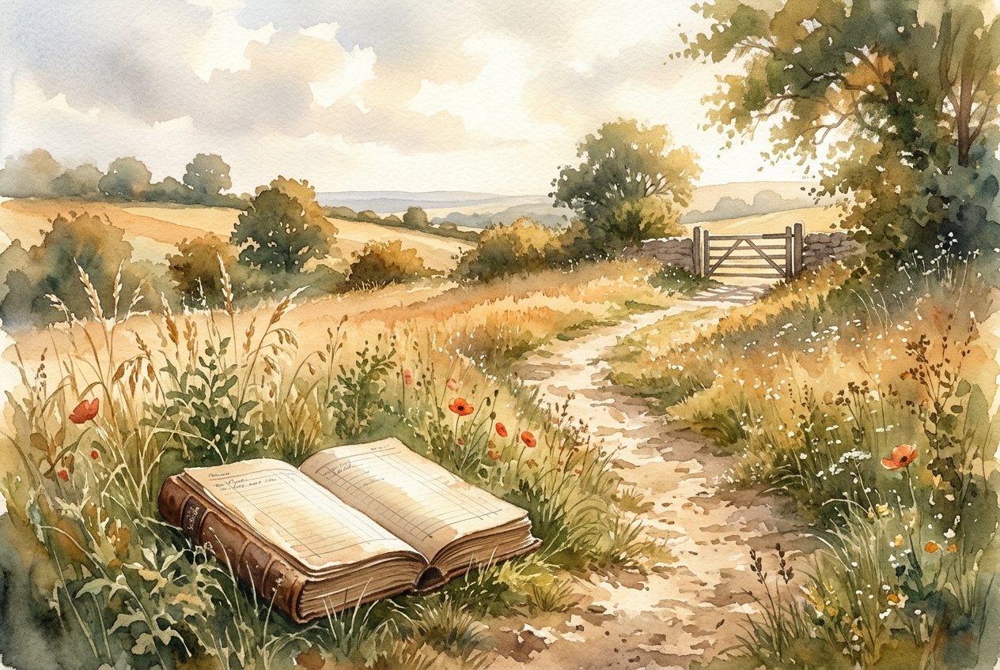

# Leitura Diária: Luke 15:11-32

*14 de novembro de 2026*

> *(Image: A dusty, sunlit path leading toward a distant open gate, with a discarded heavy ledger book resting in the foreground grass.)*

## A Leitura (PT-NVI)

**Luke 15:11-32**

> 11 Jesus continuou: "Um homem tinha dois filhos. 12 O mais novo disse ao seu pai: ‘Pai, quero a minha parte da herança’. Assim, ele repartiu sua propriedade entre eles. 13 "Não muito tempo depois, o filho mais novo reuniu tudo o que tinha, e foi para uma região distante; e lá desperdiçou os seus bens vivendo irresponsavelmente. 14 Depois de ter gasto tudo, houve uma grande fome em toda aquela região, e ele começou a passar necessidade. 15 Por isso foi empregar-se com um dos cidadãos daquela região, que o mandou para o seu campo a fim de cuidar de porcos. 16 Ele desejava encher o estômago com as vagens de alfarrobeira que os porcos comiam, mas ninguém lhe dava nada. 17 "Caindo em si, ele disse: ‘Quantos empregados de meu pai têm comida de sobra, e eu aqui, morrendo de fome! 18 Eu me porei a caminho e voltarei para meu pai, e lhe direi: Pai, pequei contra o céu e contra ti. 19 Não sou mais digno de ser chamado teu filho; trata-me como um dos teus empregados’. 20 A seguir, levantou-se e foi para seu pai. "Estando ainda longe, seu pai o viu e, cheio de compaixão, correu para seu filho, e o abraçou e beijou. 21 "O filho lhe disse: ‘Pai, pequei contra o céu e contra ti. Não sou mais digno de ser chamado teu filho’. 22 "Mas o pai disse aos seus servos: ‘Depressa! Tragam a melhor roupa e vistam nele. Coloquem um anel em seu dedo e calçados em seus pés. 23 Tragam o novilho gordo e matem-no. Vamos fazer uma festa e comemorar. 24 Pois este meu filho estava morto e voltou à vida; estava perdido e foi achado’. E começaram a festejar. 25 "Enquanto isso, o filho mais velho estava no campo. Quando se aproximou da casa, ouviu a música e a dança. 26 Então chamou um dos servos e perguntou-lhe o que estava acontecendo. 27 Este lhe respondeu: ‘Seu irmão voltou, e seu pai matou o novilho gordo, porque o recebeu de volta são e salvo’. 28 "O filho mais velho encheu-se de ira, e não quis entrar. Então seu pai saiu e insistiu com ele. 29 Mas ele respondeu ao seu pai: ‘Olha! todos esses anos tenho trabalhado como um escravo ao teu serviço e nunca desobedeci às tuas ordens. Mas tu nunca me deste nem um cabrito para eu festejar com os meus amigos. 30 Mas quando volta para casa esse seu filho, que esbanjou os teus bens com as prostitutas, matas o novilho gordo para ele! ’ 31 "Disse o pai: ‘Meu filho, você está sempre comigo, e tudo o que tenho é seu. 32 Mas nós tínhamos que comemorar e alegrar-nos, porque este seu irmão estava morto e voltou à vida, estava perdido e foi achado’ ".

## A História

Jesus compartilha esta narrativa em resposta aos líderes religiosos que murmuravam sobre as pessoas com quem ele andava. Ele descreve uma família fraturada por dois tipos muito diferentes de rebelião. O irmão mais novo se rebela através de uma independência inconsequente, exigindo sua herança antecipadamente e cortando laços para seguir seus próprios desejos. O irmão mais velho se rebela através de uma submissão rígida, ficando em casa, mas tratando sua relação com o pai como um contrato de trabalho. Quando o caçula retorna quebrado e destituído, a reação do pai quebra todas as expectativas culturais do mundo antigo, oferecendo uma restauração imediata e imerecida em vez de exigir um período de servidão.

## Aplicação para Hoje

Muitas vezes nos pegamos assumindo o papel de um desses irmãos. Às vezes fugimos para longe, convencidos de que a liberdade está na autonomia total, apenas para perceber que o que realmente desejamos é um lugar ao qual pertencer. Outras vezes, ficamos perto, mas mantemos um registro rigoroso de nossas boas ações, ressentindo secretamente aqueles que parecem receber a graça de forma fácil. A resposta do pai desafia ambos os extremos, interrompendo o pedido de desculpas ensaiado do filho mais novo e ignorando a contabilidade amarga do mais velho. A verdadeira restauração não é conquistada por um comportamento impecável, nem é perdida para sempre por nossos piores erros. Ela é simplesmente dada, convidando-nos a abandonar nossas planilhas de mérito e participar da festa.

---

*Citações bíblicas extraídas da Nova Versão Internacional (NVI), © 1993, 2000 por Biblica, Inc. Usado com permissão.*
