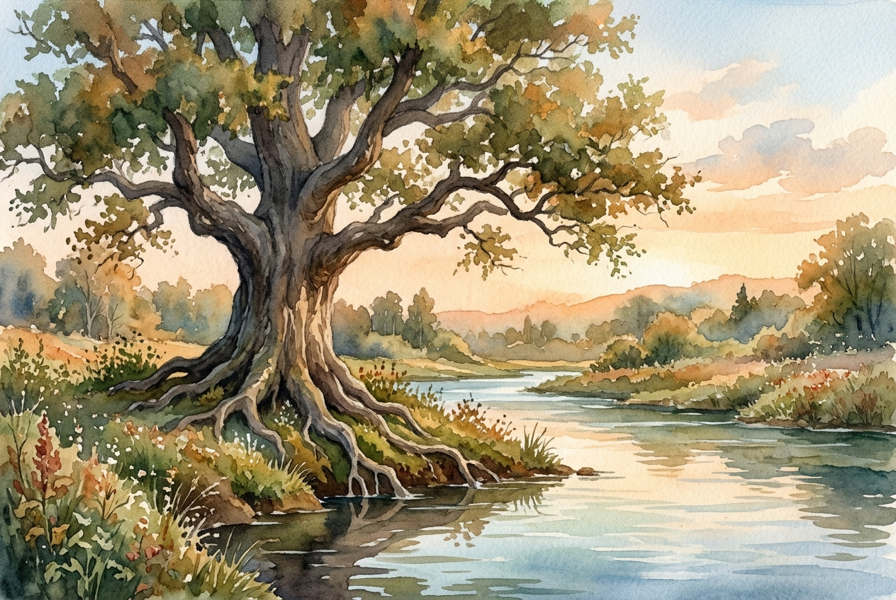

# Daily Reading: Psalm 1

*November 15, 2026*

> *(Image: A solitary, ancient tree with deep, sturdy roots thriving on the lush green bank of a gently flowing river, set against a calm and warm morning light.)*

## The Reading (NLT)

**Psalm 1**

> 1 Oh, the joys of those who do not follow the advice of the wicked, or stand around with sinners, or join in with mockers. 2 But they delight in the law of the Lord, meditating on it day and night. 3 They are like trees planted along the riverbank, bearing fruit each season. Their leaves never wither, and they prosper in all they do. 4 But not the wicked! They are like worthless chaff, scattered by the wind. 5 They will be condemned at the time of judgment. Sinners will have no place among the godly. 6 For the Lord watches over the path of the godly, but the path of the wicked leads to destruction.

## The Story

This opening poem acts as a gateway to the entire collection of Psalms, setting a foundational choice before the reader. Ancient Hebrew poetry often uses stark contrasts to make a point, and here we see two distinct ways of living laid out side by side. The imagery draws heavily from the arid landscape of the ancient Near East, where a reliable water source was the difference between life and death. A tree situated right on a riverbank does not have to rely on unpredictable rainfall because its roots tap directly into a constant supply. In contrast, the processing of grain involved tossing crushed wheat into the air so the wind could blow away the useless, weightless husks. The author uses these agricultural realities to illustrate what happens when we anchor our lives in divine wisdom versus when we allow ourselves to be shaped by cynicism.

## Application for Today

In a fast-paced world, it is easy to become detached and drift along with the loudest voices or the most popular opinions. We often find ourselves absorbing the anxiety and mockery that saturate our culture, leaving us feeling hollow and easily tossed around by circumstances. This passage invites us to examine where we are planting ourselves and what we are drawing our nutrients from. Delighting in divine instruction is not about rigid rule-keeping, but rather about finding a sustainable source of life that keeps us grounded. When we intentionally anchor our minds in God's presence, we develop a quiet resilience. We might not avoid the dry seasons, but our roots will reach deep enough to keep us healthy and capable of bringing goodness into the world.

---

*Scripture quotations are taken from the Holy Bible, New Living Translation, copyright © 1996, 2004, 2015 by Tyndale House Foundation. Used by permission of Tyndale House Publishers.*
