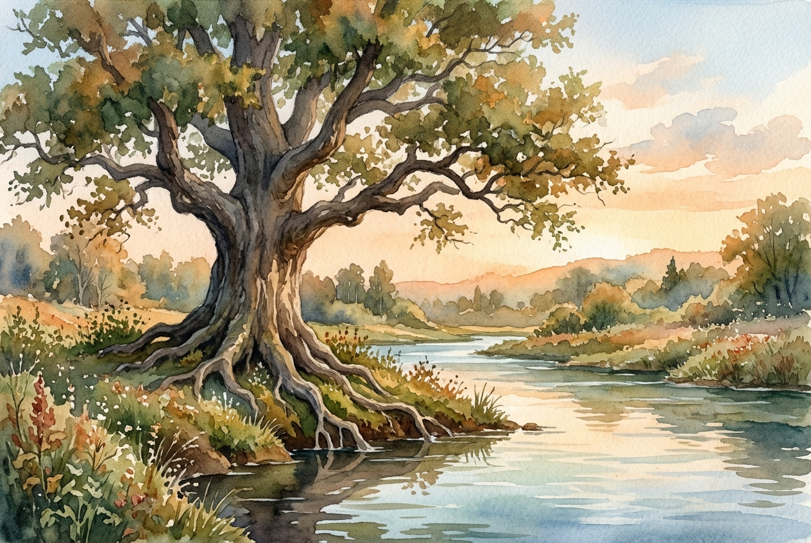

# Leitura Diária: Psalm 1

*15 de novembro de 2026*

> *(Image: A solitary, ancient tree with deep, sturdy roots thriving on the lush green bank of a gently flowing river, set against a calm and warm morning light.)*

## A Leitura (PT-NVI)

**Psalm 1**

> 1 Como é feliz aquele que não segue o conselho dos ímpios, não imita a conduta dos pecadores, nem se assenta na roda dos zombadores! 2 Ao contrário, sua satisfação está na lei do Senhor, e nessa lei medita dia e noite. 3 É como árvore plantada à beira de águas correntes: Dá fruto no tempo certo e suas folhas não murcham. Tudo o que ele faz prospera! 4 Não é o caso dos ímpios! São como palha que o vento leva. 5 Por isso os ímpios não resistirão no julgamento, nem os pecadores na comunidade dos justos. 6 Pois o Senhor aprova o caminho dos justos, mas o caminho dos ímpios leva à destruição!

## A História

Este poema de abertura funciona como um portal para toda a coleção dos Salmos, apresentando uma escolha fundamental ao leitor. A antiga poesia hebraica frequentemente usa contrastes fortes para transmitir sua mensagem, e aqui vemos dois modos de vida distintos colocados lado a lado. As imagens são fortemente inspiradas na paisagem árida do antigo Oriente Próximo, onde uma fonte de água confiável era a diferença entre a vida e a morte. Uma árvore situada na margem de um rio não precisa depender de chuvas imprevisíveis, pois suas raízes buscam sustento diretamente de um suprimento constante. Em contraste, o processamento de grãos envolvia jogar o trigo esmagado para o alto, para que o vento levasse embora as cascas inúteis e sem peso. O autor usa essas realidades agrícolas para ilustrar o que acontece quando ancoramos nossas vidas na sabedoria divina em vez de nos deixarmos moldar pelo cinismo.

## Aplicação para Hoje

Em um mundo acelerado, é fácil nos desconectarmos e sermos levados pelas vozes mais altas ou pelas opiniões mais populares. Muitas vezes acabamos absorvendo a ansiedade e a zombaria que saturam nossa cultura, o que nos deixa com uma sensação de vazio e vulneráveis às circunstâncias. Esta passagem nos convida a examinar onde estamos nos plantando e de onde estamos extraindo nossos nutrientes. Alegrar-se na instrução divina não tem a ver com o cumprimento rígido de regras, mas sim com encontrar uma fonte sustentável de vida que nos mantenha firmes. Quando ancoramos nossa mente intencionalmente na presença de Deus, desenvolvemos uma resiliência silenciosa. Podemos não evitar as estações secas, mas nossas raízes chegarão fundo o suficiente para nos manter saudáveis e capazes de semear bondade no mundo.

---

*Citações bíblicas extraídas da Nova Versão Internacional (NVI), © 1993, 2000 por Biblica, Inc. Usado com permissão.*
