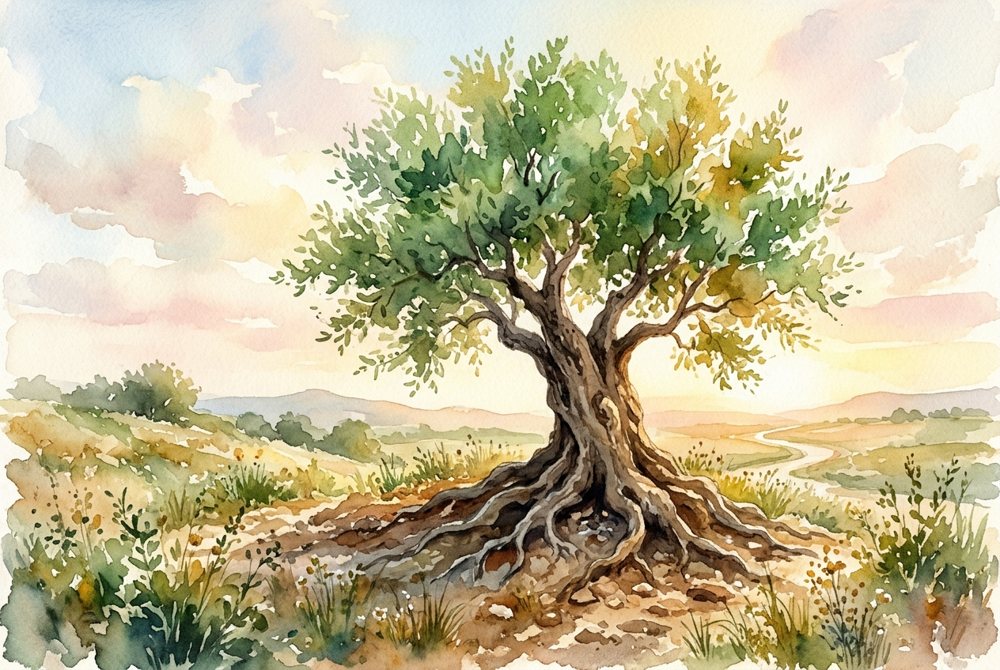

# Daily Reading: 1 Corinthians 13

*November 15, 2026*

> *(Image: A single ancient olive tree with deep exposed roots standing firmly in a sunlit field, its green leaves glowing against a soft morning sky.)*

## The Reading (NLT)

**1 Corinthians 13**

> 1 If I could speak all the languages of earth and of angels, but didn't love others, I would only be a noisy gong or a clanging cymbal. 2 If I had the gift of prophecy, and if I understood all of God's secret plans and possessed all knowledge, and if I had such faith that I could move mountains, but didn't love others, I would be nothing. 3 If I gave everything I have to the poor and even sacrificed my body, I could boast about it; but if I didn't love others, I would have gained nothing. 4 Love is patient and kind. Love is not jealous or boastful or proud 5 or rude. It does not demand its own way. It is not irritable, and it keeps no record of being wronged. 6 It does not rejoice about injustice but rejoices whenever the truth wins out. 7 Love never gives up, never loses faith, is always hopeful, and endures through every circumstance. 8 Prophecy and speaking in unknown languages and special knowledge will become useless. But love will last forever! 9 Now our knowledge is partial and incomplete, and even the gift of prophecy reveals only part of the whole picture! 10 But when the time of perfection comes, these partial things will become useless. 11 When I was a child, I spoke and thought and reasoned as a child. But when I grew up, I put away childish things. 12 Now we see things imperfectly, like puzzling reflections in a mirror, but then we will see everything with perfect clarity. All that I know now is partial and incomplete, but then I will know everything completely, just as God now knows me completely. 13 Three things will last forever faith, hope, and love and the greatest of these is love.

## The Story

The early community in Corinth was a vibrant but deeply fractured group of people. They were highly focused on spiritual status, often competing over who had the most impressive abilities, the deepest knowledge, or the most profound faith. The apostle Paul addresses this chaos by pointing them toward a completely different metric for a meaningful life. He strips away all the impressive religious achievements and insists that without a core of self-giving care for others, those accomplishments are entirely hollow. He describes a way of living that requires setting aside ego and competition in favor of patience, endurance, and humility. This shift represents a move from spiritual infancy to true maturity.

## Application for Today

It is incredibly easy to measure our spiritual growth by how much we know, how much we do, or how right we believe we are. Yet this famous letter challenges us to evaluate our lives by a much quieter, more demanding standard. True maturity is found in our capacity to be patient when we are frustrated, to celebrate the success of others without envy, and to let go of old grievances. All of our current understanding is limited and fragile, but the way we care for one another builds something permanent. When we plant ourselves in this kind of enduring care, we find a foundation that outlasts our temporary achievements. We are invited to grow up into a life where love is the only thing that truly remains.

---

*Scripture quotations are taken from the Holy Bible, New Living Translation, copyright © 1996, 2004, 2015 by Tyndale House Foundation. Used by permission of Tyndale House Publishers.*
