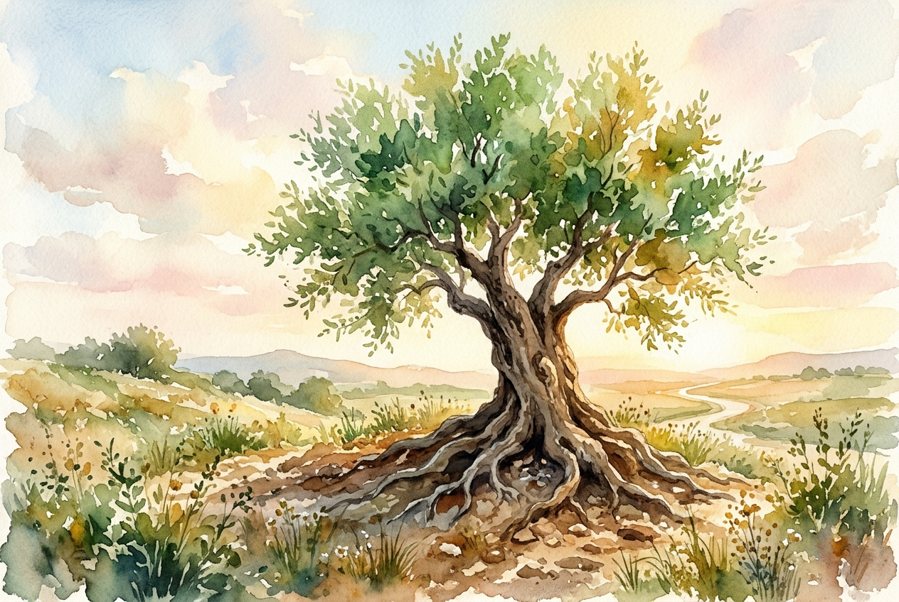

# Leitura Diária: 1 Corinthians 13

*15 de novembro de 2026*

> *(Image: A single ancient olive tree with deep exposed roots standing firmly in a sunlit field, its green leaves glowing against a soft morning sky.)*

## A Leitura (PT-NVI)

**1 Corinthians 13**

> 1 Ainda que eu fale as línguas dos homens e dos anjos, se não tiver amor, serei como o sino que ressoa ou como o prato que retine. 2 Ainda que eu tenha o dom de profecia e saiba todos os mistérios e todo o conhecimento, e tenha uma fé capaz de mover montanhas, mas não tiver amor, nada serei. 3 Ainda que eu dê aos pobres tudo o que possuo e entregue o meu corpo para ser queimado, mas não tiver amor, nada disso me valerá. 4 O amor é paciente, o amor é bondoso. Não inveja, não se vangloria, não se orgulha. 5 Não maltrata, não procura seus interesses, não se ira facilmente, não guarda rancor. 6 O amor não se alegra com a injustiça, mas se alegra com a verdade. 7 Tudo sofre, tudo crê, tudo espera, tudo suporta. 8 O amor nunca perece; mas as profecias desaparecerão, as línguas cessarão, o conhecimento passará. 9 Pois em parte conhecemos e em parte profetizamos; 10 quando, porém, vier o que é perfeito, o que é imperfeito desaparecerá. 11 Quando eu era menino, falava como menino, pensava como menino e raciocinava como menino. Quando me tornei homem, deixei para trás as coisas de menino. 12 Agora, pois, vemos apenas um reflexo obscuro, como em espelho; mas, então, veremos face a face. Agora conheço em parte; então, conhecerei plenamente, da mesma forma como sou plenamente conhecido. 13 Assim, permanecem agora estes três: a fé, a esperança e o amor. O maior deles, porém, é o amor.

## A História

A comunidade primitiva em Corinto era um grupo vibrante, mas profundamente fragmentado. Eles estavam muito focados em status espiritual, frequentemente competindo para ver quem tinha as habilidades mais impressionantes, o conhecimento mais profundo ou a fé mais inabalável. O apóstolo Paulo lida com esse caos apontando para uma métrica completamente diferente de uma vida com propósito. Ele remove todas as conquistas religiosas impressionantes e insiste que, sem uma essência de cuidado altruísta pelos outros, esses feitos são totalmente vazios. Paulo descreve uma maneira de viver que exige deixar de lado o ego e a competição em favor da paciência, da perseverança e da humildade. Essa mudança representa a transição da infância espiritual para a verdadeira maturidade.

## Aplicação para Hoje

É incrivelmente fácil medir nosso crescimento espiritual pelo quanto sabemos, pelo que fazemos ou pela certeza que temos de estar certos. No entanto, esta famosa carta nos desafia a avaliar nossas vidas por um padrão muito mais silencioso e exigente. A verdadeira maturidade se encontra na nossa capacidade de ter paciência quando estamos frustrados, de celebrar o sucesso alheio sem inveja e de abrir mão de velhos ressentimentos. Toda a nossa compreensão atual é limitada e frágil, mas a forma como cuidamos uns dos outros constrói algo permanente. Quando nos firmamos nesse tipo de cuidado duradouro, encontramos um alicerce que sobrevive às nossas conquistas temporárias. Somos convidados a amadurecer para uma vida onde o amor é a única coisa que realmente permanece.

---

*Citações bíblicas extraídas da Nova Versão Internacional (NVI), © 1993, 2000 por Biblica, Inc. Usado com permissão.*
