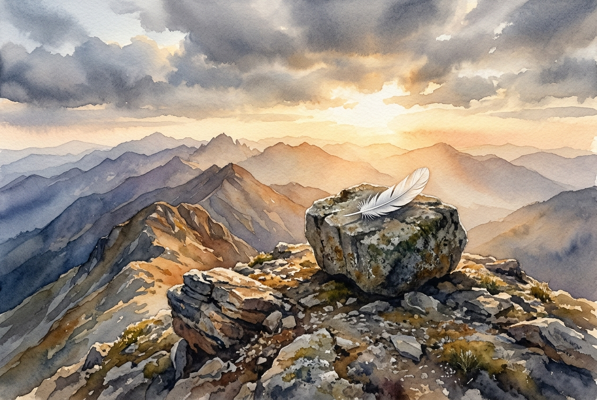

# Daily Reading: Isaiah 40:28-31

*November 17, 2026*

> *(Image: A lone feather resting on a weathered stone at the peak of a rugged mountain, illuminated by the soft golden light of dawn breaking through heavy clouds.)*

## The Reading (NLT)

**Isaiah 40:28-31**

> 28 Have you never heard? Have you never understood? The Lord is the everlasting God, the Creator of all the earth. He never grows weak or weary. No one can measure the depths of his understanding. 29 He gives power to the weak and strength to the powerless. 30 Even youths will become weak and tired, and young men will fall in exhaustion. 31 But those who trust in the Lord will find new strength. They will soar high on wings like eagles. They will run and not grow weary. They will walk and not faint.

## The Story

Isaiah is speaking to a community that feels forgotten and entirely depleted. The exiles in Babylon are looking at their circumstances and wondering if their Creator has lost track of them or simply run out of power to save them. The prophet responds by zooming out to the cosmic scale, reminding them of the Maker's eternal nature. He draws a sharp contrast between the absolute peak of human vitality and the inexhaustible reality of the Divine. Even the most capable and energetic among us will eventually hit a wall and collapse. Yet the source of all life never experiences fatigue, and this boundless energy is meant to be shared with those who recognize their own limits.

## Application for Today

We live in a culture that praises relentless hustle and self-reliance, pushing us to manufacture our own energy until we burn out. When we inevitably crash, we often feel a sense of failure, as if we were supposed to be machines. This ancient poetry invites us to accept our human frailty not as a flaw, but as the very place where we connect with the eternal. Trusting the Divine means relinquishing the pressure to sustain ourselves through our own sheer willpower. As we learn to wait and rest in that infinite source, we find a different kind of stamina. It is a quiet, enduring resilience that allows us to keep moving forward, long after our personal reserves have dried up.

---

*Scripture quotations are taken from the Holy Bible, New Living Translation, copyright © 1996, 2004, 2015 by Tyndale House Foundation. Used by permission of Tyndale House Publishers.*
