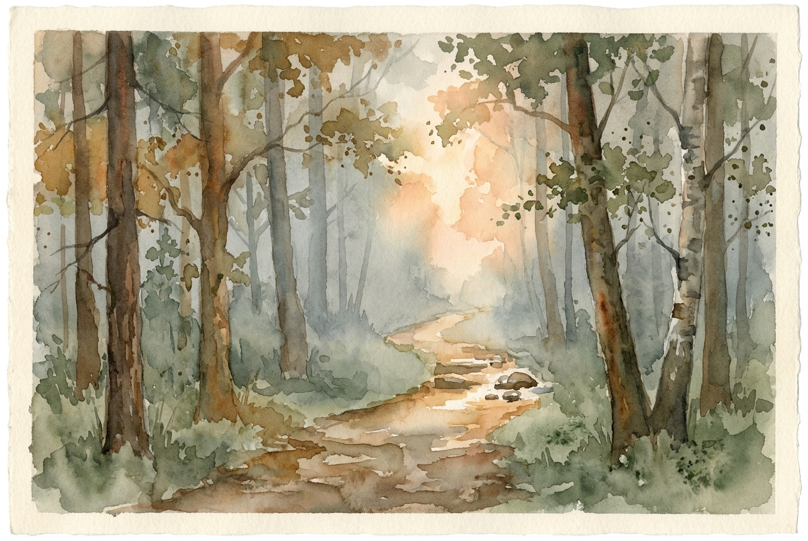

# Daily Reading: Proverbs 3:5-8

*November 18, 2026*

> *(Image: A winding dirt path through a dense, misty forest with a soft, warm light breaking through the canopy ahead, illuminating just the next few steps.)*

## The Reading (NLT)

**Proverbs 3:5-8**

> 5 Trust in the Lord with all your heart; do not depend on your own understanding. 6 Seek his will in all you do, and he will show you which path to take. 7 Don't be impressed with your own wisdom. Instead, fear the Lord and turn away from evil. 8 Then you will have healing for your body and strength for your bones.

## The Story

The wisdom literature of ancient Israel often contrasts human limitation with divine perspective. In this section, a teacher urges a student to release the exhausting burden of having to figure everything out. Human understanding is depicted not as useless, but as an unstable foundation if leaned upon entirely. True wisdom begins with acknowledging that our vantage point is incredibly small. The ancient writers understood that trying to control every outcome leads to physical and spiritual burnout. By choosing reverence for the divine over our own cleverness, we align ourselves with a much larger, more secure reality.

## Application for Today

We live in an era that prizes self-reliance and constant optimization. We are told to chart our own courses and trust our own instincts, which can leave us feeling incredibly anxious when we hit a dead end. This ancient wisdom invites us to lay down the heavy backpack of having to know it all. When we stop trying to outsmart our circumstances and instead invite God into our daily decisions, something shifts inside us. The pressure lifts, bringing a profound sense of relief that reaches all the way to our bones. We do not have to see the whole map to take the next faithful step.

---

*Scripture quotations are taken from the Holy Bible, New Living Translation, copyright © 1996, 2004, 2015 by Tyndale House Foundation. Used by permission of Tyndale House Publishers.*
