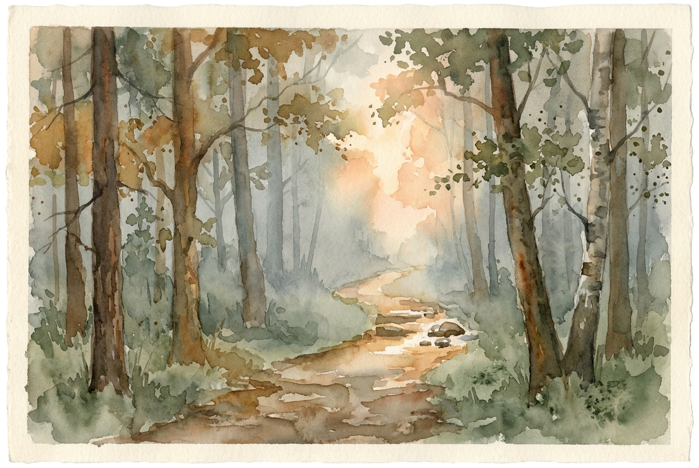

# Leitura Diária: Proverbs 3:5-8

*18 de novembro de 2026*

> *(Image: A winding dirt path through a dense, misty forest with a soft, warm light breaking through the canopy ahead, illuminating just the next few steps.)*

## A Leitura (PT-NVI)

**Proverbs 3:5-8**

> 5 Confie no Senhor de todo o seu coração e não se apóie em seu próprio entendimento; 6 reconheça o Senhor em todos os seus caminhos, e ele endireitará as suas veredas. 7 Não seja sábio aos seus próprios olhos; tema ao Senhor e evite o mal. 8 Isso lhe dará saúde ao corpo e vigor aos ossos.

## A História

A literatura de sabedoria do antigo Israel frequentemente contrasta a limitação humana com a perspectiva divina. Nesta seção, um mestre incentiva seu aluno a se libertar do fardo exaustivo de ter que descobrir as respostas para tudo. O entendimento humano não é retratado como inútil, mas como uma fundação instável se dependermos inteiramente dele. A verdadeira sabedoria começa ao reconhecermos que nosso ponto de vista é incrivelmente restrito. Os antigos escritores entendiam que tentar controlar cada resultado leva ao esgotamento físico e espiritual. Ao escolhermos a reverência ao divino em vez da nossa própria astúcia, nos alinhamos a uma realidade muito mais ampla e segura.

## Aplicação para Hoje

Vivemos em uma época que valoriza a autossuficiência e a otimização constante. Somos ensinados a traçar nossos próprios caminhos e a confiar em nossos instintos, o que pode nos deixar extremamente ansiosos quando chegamos a um beco sem saída. Essa sabedoria milenar nos convida a largar a pesada bagagem de ter que saber de tudo. Quando paramos de tentar ser mais espertos que as nossas circunstâncias e, em vez disso, convidamos Deus para nossas decisões diárias, algo muda dentro de nós. A pressão diminui, trazendo uma profunda sensação de alívio que atinge até os nossos ossos. Não precisamos ver o mapa inteiro para dar o próximo passo de fé.

---

*Citações bíblicas extraídas da Nova Versão Internacional (NVI), © 1993, 2000 por Biblica, Inc. Usado com permissão.*
