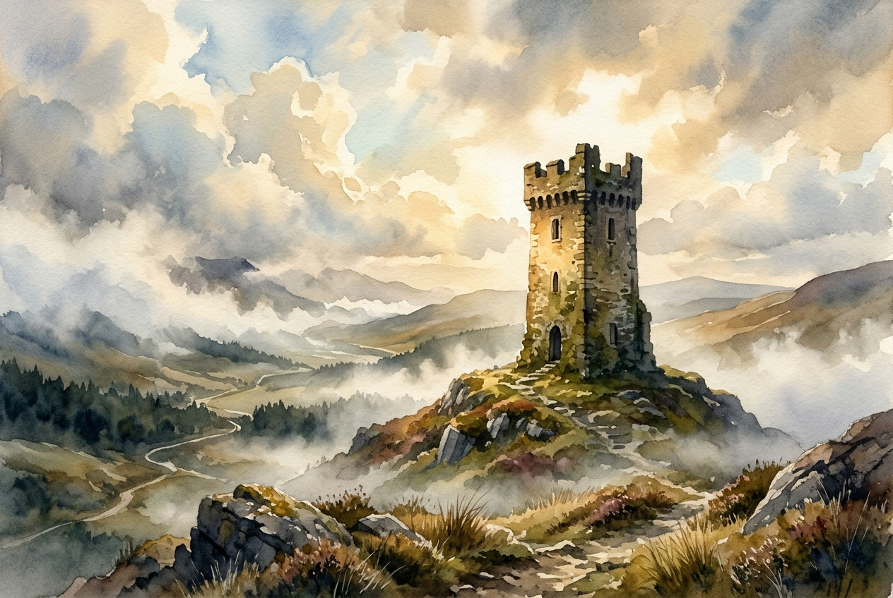

# Daily Reading: Psalm 91

*November 18, 2026*

> *(Image: A solitary, ancient stone tower standing strong amidst a swirling, misty landscape, illuminated by a soft, warm light breaking through the clouds.)*

## The Reading (NLT)

**Psalm 91**

> 1 Those who live in the shelter of the Most High will find rest in the shadow of the Almighty. 2 This I declare about the Lord: He alone is my refuge, my place of safety; he is my God, and I trust him. 3 For he will rescue you from every trap and protect you from deadly disease. 4 He will cover you with his feathers. He will shelter you with his wings. His faithful promises are your armor and protection. 5 Do not be afraid of the terrors of the night, nor the arrow that flies in the day. 6 Do not dread the disease that stalks in darkness, nor the disaster that strikes at midday. 7 Though a thousand fall at your side, though ten thousand are dying around you, these evils will not touch you. 8 Just open your eyes, and see how the wicked are punished. 9 If you make the Lord your refuge, if you make the Most High your shelter, 10 no evil will conquer you; no plague will come near your home. 11 For he will order his angels to protect you wherever you go. 12 They will hold you up with their hands so you won't even hurt your foot on a stone. 13 You will trample upon lions and cobras; you will crush fierce lions and serpents under your feet! 14 The Lord says, I will rescue those who love me. I will protect those who trust in my name. 15 When they call on me, I will answer; I will be with them in trouble. I will rescue and honor them. 16 I will reward them with a long life and give them my salvation.

## The Story

Ancient poetry often utilizes vivid, physical imagery to describe abstract spiritual realities. The psalmist paints a picture of ultimate security using the metaphor of a mother bird shielding her young and a fortified stone shelter. Historically, the original audience lived in a world where physical threats like disease, wild animals, and sudden ambushes were daily realities. In the face of such vulnerability, the writer points to a reality deeper than the surrounding dangers. The song does not promise that frightening things will vanish from the earth. Instead, it offers a profound assurance that the divine presence remains an impenetrable sanctuary.

## Application for Today

We spend an immense amount of energy trying to build our own fortresses against the uncertainties of life. We obsess over contingencies, trying to anticipate every possible threat in order to keep ourselves secure. Yet, true rest is found when we finally stop trying to armor ourselves. The invitation here is to step into a shelter that has already been built for us. When we lean into the presence of the divine, we discover a quiet confidence that sustains us through the darkest nights. We are held by a love that stands firm no matter what chaos swirls outside.

---

*Scripture quotations are taken from the Holy Bible, New Living Translation, copyright © 1996, 2004, 2015 by Tyndale House Foundation. Used by permission of Tyndale House Publishers.*
