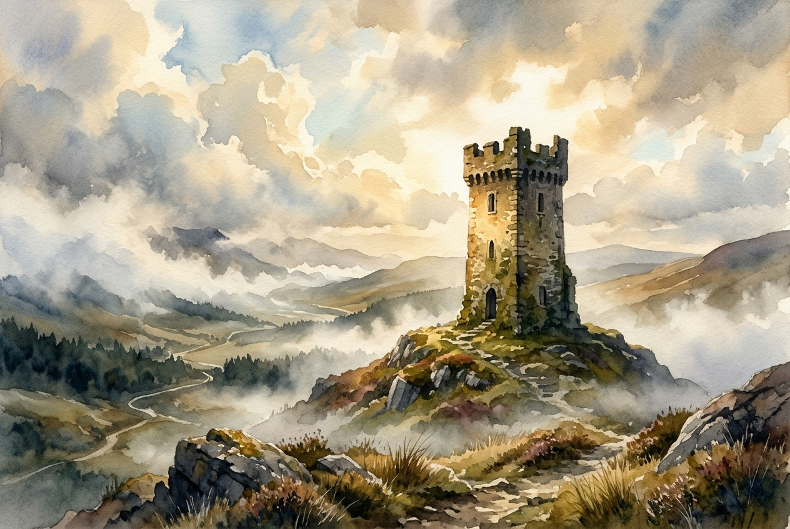

# Leitura Diária: Psalm 91

*18 de novembro de 2026*

> *(Image: A solitary, ancient stone tower standing strong amidst a swirling, misty landscape, illuminated by a soft, warm light breaking through the clouds.)*

## A Leitura (PT-NVI)

**Psalm 91**

> 1 Aquele que habita no abrigo do Altíssimo e descansa à sombra do Todo-poderoso 2 pode dizer ao Senhor: Tu és o meu refúgio e a minha fortaleza, o meu Deus, em quem confio. 3 Ele o livrará do laço do caçador e do veneno mortal. 4 Ele o cobrirá com as suas penas, e sob as suas asas você encontrará refúgio; a fidelidade dele será o seu escudo protetor. 5 Você não temerá o pavor da noite, nem a flecha que voa de dia, 6 nem a peste que se move sorrateira nas trevas, nem a praga que devasta ao meio-dia. 7 Mil poderão cair ao seu lado, dez mil à sua direita, mas nada o atingirá. 8 Você simplesmente olhará, e verá o castigo dos ímpios. 9 Se você fizer do Altíssimo o seu refúgio, 10 nenhum mal o atingirá, desgraça alguma chegará à sua tenda. 11 Porque a seus anjos ele dará ordens a seu respeito, para que o protejam em todos os seus caminhos; 12 com as mãos eles o segurarão, para que você não tropece em alguma pedra. 13 Você pisará o leão e a cobra; pisoteará o leão forte e a serpente. 14 "Porque ele me ama, eu o resgatarei; eu o protegerei, pois conhece o meu nome. 15 Ele clamará a mim, e eu lhe darei resposta, e na adversidade estarei com ele; vou livrá-lo e cobri-lo de honra. 16 Vida longa eu lhe darei, e lhe mostrarei a minha salvação. "

## A História

A poesia antiga frequentemente utiliza imagens físicas e vívidas para descrever realidades espirituais abstratas. O salmista pinta um quadro de segurança máxima usando a metáfora de uma ave protegendo seus filhotes e de um abrigo de pedra fortificado. Historicamente, o público original vivia em um mundo onde ameaças físicas, como doenças, animais selvagens e emboscadas repentinas, eram realidades diárias. Diante de tamanha vulnerabilidade, o autor aponta para uma realidade mais profunda do que os perigos ao redor. O cântico não promete que as coisas assustadoras desaparecerão da terra. Em vez disso, oferece a profunda garantia de que a presença divina permanece como um santuário impenetrável.

## Aplicação para Hoje

Gastamos uma quantidade imensa de energia tentando construir nossas próprias fortalezas contra as incertezas da vida. Ficamos obcecados com imprevistos, tentando antecipar todas as ameaças possíveis para nos mantermos seguros. No entanto, o verdadeiro descanso é encontrado quando finalmente paramos de tentar nos blindar com nossas próprias forças. O convite aqui é para entrar em um abrigo que já foi construído para nós. Quando nos apoiamos na presença divina, descobrimos uma confiança silenciosa que nos sustenta nas noites mais escuras. Somos amparados por um amor que permanece firme, independentemente do caos que gire do lado de fora.

---

*Citações bíblicas extraídas da Nova Versão Internacional (NVI), © 1993, 2000 por Biblica, Inc. Usado com permissão.*
