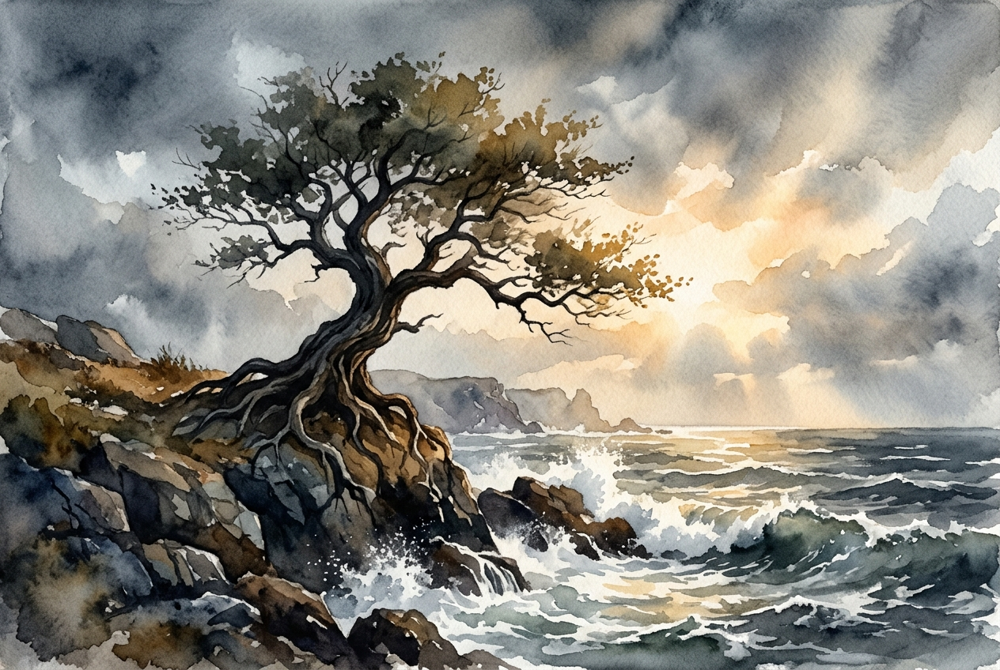

# Daily Reading: James 1:2-8

*November 19, 2026*

> *(Image: A solitary, ancient tree with deep roots gripping a rocky coastline, standing firm as ocean waves crash and winds blow, illuminated by a warm, breaking sunlight through stormy clouds.)*

## The Reading (NLT)

**James 1:2-8**

> 2 Dear brothers and sisters, when troubles of any kind come your way, consider it an opportunity for great joy. 3 For you know that when your faith is tested, your endurance has a chance to grow. 4 So let it grow, for when your endurance is fully developed, you will be perfect and complete, needing nothing. 5 If you need wisdom, ask our generous God, and he will give it to you. He will not rebuke you for asking. 6 But when you ask him, be sure that your faith is in God alone. Do not waver, for a person with divided loyalty is as unsettled as a wave of the sea that is blown and tossed by the wind. 7 Such people should not expect to receive anything from the Lord. 8 Their loyalty is divided between God and the world, and they are unstable in everything they do.

## The Story

James addresses a scattered, vulnerable community of early believers who were facing intense social and economic pressure. Rather than offering a quick escape route, he reframes their hardship as a crucible for character. The letter suggests that facing difficult circumstances is exactly how spiritual stamina is forged. He introduces the image of a wind-tossed sea to describe the mind that tries to rely on God while still clinging to the security of the surrounding culture, noting that this divided loyalty creates a chaotic instability.

## Application for Today

We often view our struggles as interruptions to our actual lives, treating them as obstacles to simply survive and put behind us. Yet this passage invites us to see our hardest seasons as the very places where our deepest maturity is formed. When we do not know how to navigate the pressure, we are invited to ask for the wisdom we lack, trusting that God is generous rather than critical. The challenge is to bring our whole selves to that request, refusing to hedge our bets by seeking ultimate security in our wealth, status, or own cleverness. True stability comes when we commit our trust fully to God, allowing the winds to blow while we remain securely grounded in his care.

---

*Scripture quotations are taken from the Holy Bible, New Living Translation, copyright © 1996, 2004, 2015 by Tyndale House Foundation. Used by permission of Tyndale House Publishers.*
