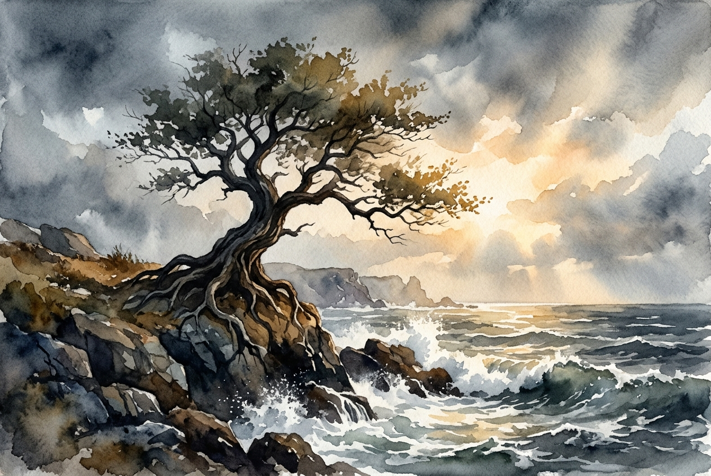

# Leitura Diária: James 1:2-8

*19 de novembro de 2026*

> *(Image: A solitary, ancient tree with deep roots gripping a rocky coastline, standing firm as ocean waves crash and winds blow, illuminated by a warm, breaking sunlight through stormy clouds.)*

## A Leitura (PT-NVI)

**James 1:2-8**

> 2 Meus irmãos, considerem motivo de grande alegria o fato de passarem por diversas provações, 3 pois vocês sabem que a prova da sua fé produz perseverança. 4 E a perseverança deve ter ação completa, a fim de que vocês sejam maduros e íntegros, sem lhes faltar coisa alguma. 5 Se algum de vocês tem falta de sabedoria, peça-a a Deus, que a todos dá livremente, de boa vontade; e lhe será concedida. 6 Peça-a, porém, com fé, sem duvidar, pois aquele que duvida é semelhante à onda do mar, levada e agitada pelo vento. 7 Não pense tal homem que receberá coisa alguma do Senhor; 8 é alguém que tem mente dividida e é instável em tudo o que faz.

## A História

Tiago escreve para uma comunidade dispersa e vulnerável de cristãos primitivos que enfrentava intensa pressão social e econômica. Em vez de oferecer uma rota de fuga rápida, ele ressignifica a dificuldade deles como um crisol para o caráter. A carta sugere que enfrentar circunstâncias difíceis é exatamente a maneira como a resistência espiritual é forjada. Ele introduz a imagem de um mar agitado pelo vento para descrever a mente que tenta confiar no divino enquanto ainda se apega à segurança da cultura ao redor, observando que essa lealdade dividida cria uma instabilidade caótica.

## Aplicação para Hoje

Muitas vezes vemos nossas lutas como interrupções de nossas vidas reais, tratando-as como obstáculos aos quais devemos simplesmente sobreviver. No entanto, este texto nos convida a ver nossas estações mais difíceis como os exatos lugares onde nossa maturidade mais profunda é formada. Quando não sabemos como lidar com a pressão, somos convidados a buscar a sabedoria que nos falta, confiando que o Criador é generoso, não crítico. O desafio é nos entregarmos por inteiro a esse pedido, recusando a tentação de garantir nossa segurança final na riqueza, no status ou em nossa própria esperteza. A verdadeira estabilidade surge quando depositamos nossa confiança inteiramente em Deus, permitindo que os ventos soprem enquanto permanecemos firmemente enraizados em seu cuidado.

---

*Citações bíblicas extraídas da Nova Versão Internacional (NVI), © 1993, 2000 por Biblica, Inc. Usado com permissão.*
