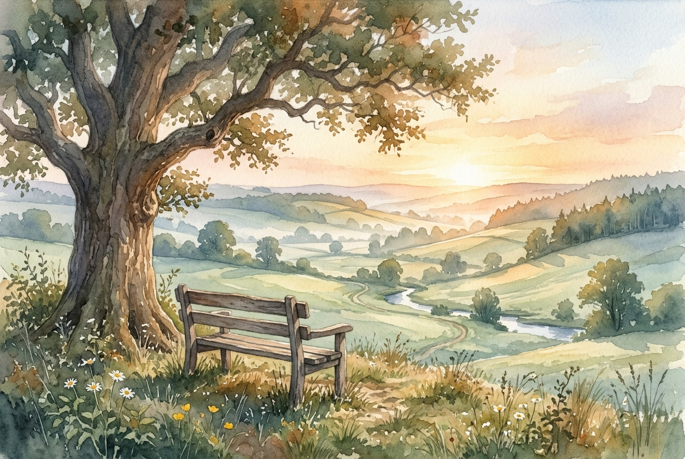

# Daily Reading: Matthew 11:28-30

*November 20, 2026*

> *(Image: A gentle morning light breaking over a quiet green valley, illuminating a worn wooden bench resting under the shade of an ancient oak tree.)*

## The Reading (NLT)

**Matthew 11:28-30**

> 28 Then Jesus said, Come to me, all of you who are weary and carry heavy burdens, and I will give you rest. 29 Take my yoke upon you. Let me teach you, because I am humble and gentle at heart, and you will find rest for your souls. 30 For my yoke is easy to bear, and the burden I give you is light.

## The Story

In the first-century agrarian world, a yoke was a familiar sight. It was a heavy wooden beam crafted to fit across the shoulders of two oxen, allowing them to pull a plow together. Religious teachers of the time often used this farming tool as a metaphor for the obligation of keeping the law. For the everyday people listening to this teaching, that religious duty had become a crushing weight of endless rules and impossible standards. The alternative presented in this passage shifts the entire paradigm of spiritual life. It frames discipleship not as a solitary struggle under harsh demands, but as a shared walk with a compassionate guide.

## Application for Today

We often carry exhaustion in our bones, weighed down by the demands of our culture, our careers, and even our own expectations. Sometimes we turn faith itself into another exhausting checklist of things we must accomplish to be acceptable. Yet the divine invitation asks us to step out of that endless cycle of striving. We are encouraged to link our lives with one who intimately understands human frailty. True spiritual rest does not necessarily mean our external problems vanish overnight. Instead, it means we no longer pull the heavy weight of life alone, allowing a profound peace to settle into our tired souls.

---

*Scripture quotations are taken from the Holy Bible, New Living Translation, copyright © 1996, 2004, 2015 by Tyndale House Foundation. Used by permission of Tyndale House Publishers.*
