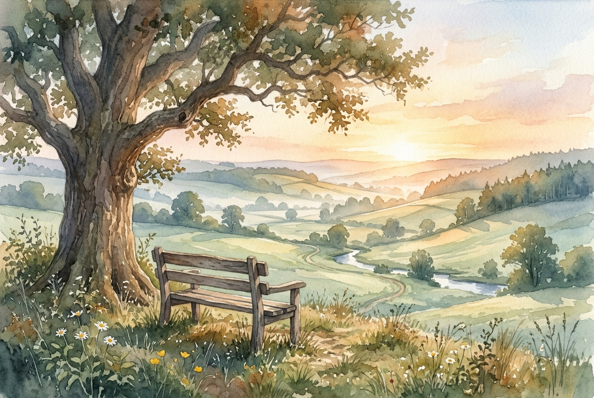

# Leitura Diária: Matthew 11:28-30

*20 de novembro de 2026*

> *(Image: A gentle morning light breaking over a quiet green valley, illuminating a worn wooden bench resting under the shade of an ancient oak tree.)*

## A Leitura (PT-NVI)

**Matthew 11:28-30**

> 28 "Venham a mim, todos os que estão cansados e sobrecarregados, e eu lhes darei descanso. 29 Tomem sobre vocês o meu jugo e aprendam de mim, pois sou manso e humilde de coração, e vocês encontrarão descanso para as suas almas. 30 Pois o meu jugo é suave e o meu fardo é leve".

## A História

No mundo agrário do primeiro século, o jugo era um instrumento de trabalho muito comum. Tratava-se de uma pesada trave de madeira desenhada para unir dois animais, permitindo que arassem a terra juntos. Os mestres religiosos da época costumavam usar essa imagem como metáfora para a obrigação de cumprir as leis e tradições. Para as pessoas comuns que ouviam essa mensagem, as exigências religiosas haviam se tornado um peso esmagador de regras inatingíveis. A alternativa apresentada neste texto muda completamente a dinâmica da vida espiritual. O discipulado deixa de ser uma caminhada solitária sob cobranças implacáveis para se tornar uma jornada compartilhada com um guia acolhedor.

## Aplicação para Hoje

Muitas vezes carregamos um cansaço profundo, fruto das pressões da sociedade, do trabalho e das nossas próprias autocobranças. Chegamos até mesmo a transformar a espiritualidade em mais uma lista exaustiva de tarefas para tentar provar nosso valor. O convite divino, porém, é para abandonarmos essa rotina de esforço contínuo e exaustivo. Somos chamados a caminhar lado a lado com quem compreende perfeitamente a nossa fragilidade. O verdadeiro descanso interior não significa a ausência mágica de desafios no dia a dia. Significa, na verdade, a certeza de que não precisamos mais puxar o arado sozinhos, abrindo espaço para que a paz restaure nossas forças.

---

*Citações bíblicas extraídas da Nova Versão Internacional (NVI), © 1993, 2000 por Biblica, Inc. Usado com permissão.*
