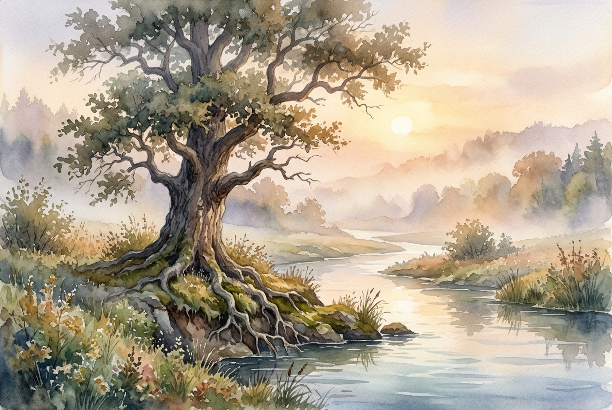

# Daily Reading: Psalm 1

*November 20, 2026*

> *(Image: A serene, contemplative landscape showing a strong, ancient tree with deep roots growing right on the edge of a gently flowing river, set against a soft morning mist.)*

## The Reading (NLT)

**Psalm 1**

> 1 Oh, the joys of those who do not follow the advice of the wicked, or stand around with sinners, or join in with mockers. 2 But they delight in the law of the Lord, meditating on it day and night. 3 They are like trees planted along the riverbank, bearing fruit each season. Their leaves never wither, and they prosper in all they do. 4 But not the wicked! They are like worthless chaff, scattered by the wind. 5 They will be condemned at the time of judgment. Sinners will have no place among the godly. 6 For the Lord watches over the path of the godly, but the path of the wicked leads to destruction.

## The Story

The Book of Psalms opens not with a prayer or a hymn, but with a piece of wisdom literature that sets the tone for the entire collection. This ancient song presents a stark contrast between two ways of living, using agricultural imagery that would have been deeply familiar to its original audience. On one side is the chaff, the dry and weightless outer shell of grain that is easily swept away by the slightest breeze. On the other side is a thriving tree, intentionally placed near a continuous water source. This tree doesn't have to strive for its survival because its roots have constant access to what it needs. The text suggests that true joy is found not in following cynical crowds, but in finding deep, sustaining satisfaction in divine instruction.

## Application for Today

We often treat spiritual growth as a grueling project, something we must achieve through sheer willpower and exhaustion. Yet this opening psalm offers a completely different picture of a flourishing life. When we sink our roots into God's wisdom, we are simply drawing up the nourishment that is already flowing right beside us. We don't have to force the fruit to grow or panic when the seasons change. There is a profound relief in knowing that our stability doesn't depend on the shifting opinions of the world around us. By quietly turning our attention to what is good and true, we find a steady source of life that keeps us grounded and growing, even in the driest times.

---

*Scripture quotations are taken from the Holy Bible, New Living Translation, copyright © 1996, 2004, 2015 by Tyndale House Foundation. Used by permission of Tyndale House Publishers.*
