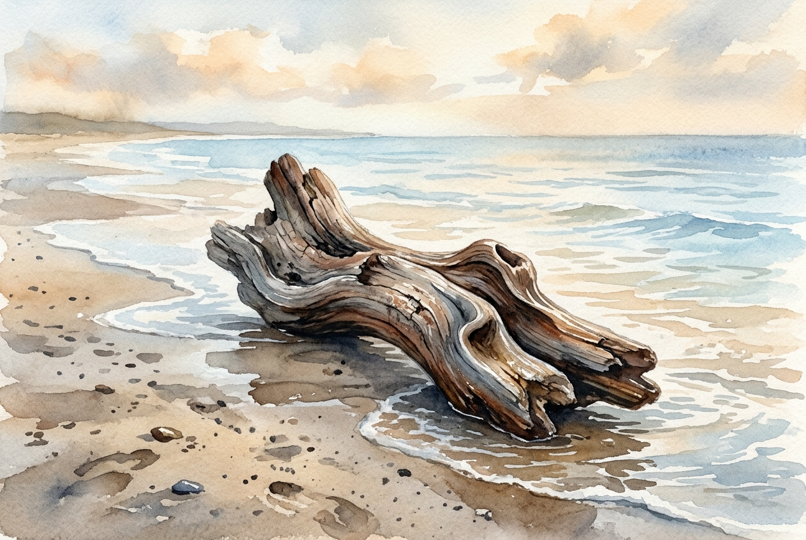

# Daily Reading: Ephesians 2:1-10

*November 21, 2026*

> *(Image: A weathered piece of driftwood resting on a quiet shore, slowly being carved and polished by the gentle, steady movement of the tide.)*

## The Reading (NLT)

**Ephesians 2:1-10**

> 1 Once you were dead because of your disobedience and your many sins. 2 You used to live in sin, just like the rest of the world, obeying the devil the commander of the powers in the unseen world. He is the spirit at work in the hearts of those who refuse to obey God. 3 All of us used to live that way, following the passionate desires and inclinations of our sinful nature. By our very nature we were subject to God's anger, just like everyone else. 4 But God is so rich in mercy, and he loved us so much, 5 that even though we were dead because of our sins, he gave us life when he raised Christ from the dead. (It is only by God's grace that you have been saved!) 6 For he raised us from the dead along with Christ and seated us with him in the heavenly realms because we are united with Christ Jesus. 7 So God can point to us in all future ages as examples of the incredible wealth of his grace and kindness toward us, as shown in all he has done for us who are united with Christ Jesus. 8 God saved you by his grace when you believed. And you can't take credit for this; it is a gift from God. 9 Salvation is not a reward for the good things we have done, so none of us can boast about it. 10 For we are God's masterpiece. He has created us anew in Christ Jesus, so we can do the good things he planned for us long ago.

## The Story

The letter to the Ephesians paints a stark contrast between two ways of existing. The author describes a past life driven by the exhausting, self-centered rhythms of the surrounding culture, a state so disconnected from the divine that it is likened to being lifeless. Then comes a dramatic pivot, rooted entirely in the character of the Creator rather than the merit of the people. Through an outpouring of mercy, a rescue operation takes place that no human effort could achieve. The text emphasizes that this restoration is a pure gift, completely dismantling any reason for human pride. The beautiful conclusion is that people are not just salvaged, but purposefully reshaped as a divine masterpiece.

## Application for Today

It is deeply human to want to earn our keep, to build a resume of good deeds that proves our worth to the world and to the divine. We often treat our faith like a ladder we have to climb through sheer willpower. Yet this passage invites us to step off the treadmill of performance. You are not a project to be completed or a worker hired to earn a wage; you are a work of art crafted by a loving maker. The good things we do are not the payment for our rescue, but the natural expression of our new identity. When we realize our value is a secure gift, we are finally free to step into the meaningful life prepared for us with joy instead of anxiety.

---

*Scripture quotations are taken from the Holy Bible, New Living Translation, copyright © 1996, 2004, 2015 by Tyndale House Foundation. Used by permission of Tyndale House Publishers.*
