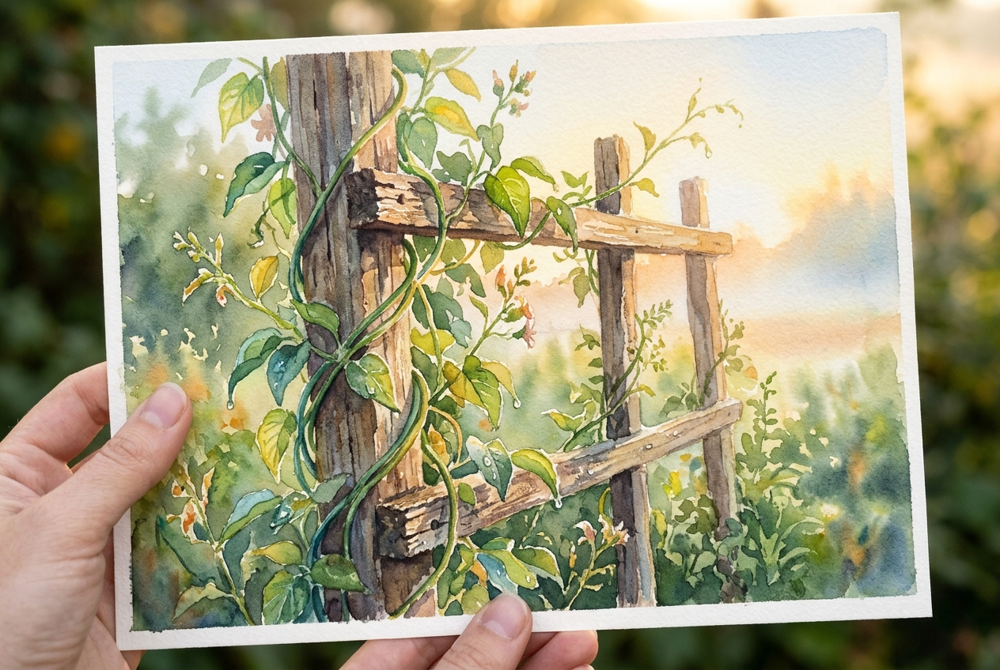

# Daily Reading: John 15:1-11

*November 21, 2026*

> *(Image: A close-up view of a vibrant green vine winding around a rustic wooden trellis, bathed in the warm, golden light of early morning.)*

## The Reading (NLT)

**John 15:1-11**

> 1 I am the true grapevine, and my Father is the gardener. 2 He cuts off every branch of mine that doesn't produce fruit, and he prunes the branches that do bear fruit so they will produce even more. 3 You have already been pruned and purified by the message I have given you. 4 Remain in me, and I will remain in you. For a branch cannot produce fruit if it is severed from the vine, and you cannot be fruitful unless you remain in me. 5 Yes, I am the vine; you are the branches. Those who remain in me, and I in them, will produce much fruit. For apart from me you can do nothing. 6 Anyone who does not remain in me is thrown away like a useless branch and withers. Such branches are gathered into a pile to be burned. 7 But if you remain in me and my words remain in you, you may ask for anything you want, and it will be granted! 8 When you produce much fruit, you are my true disciples. This brings great glory to my Father. 9 I have loved you even as the Father has loved me. Remain in my love. 10 When you obey my commandments, you remain in my love, just as I obey my Father's commandments and remain in his love. 11 I have told you these things so that you will be filled with my joy. Yes, your joy will overflow!

## The Story

Jesus continues to speak to his closest friends during their final meal together, offering a powerful image of connection to anchor them in the coming storm. He describes himself as a grapevine and his followers as the branches, with God acting as the careful gardener. In the ancient Mediterranean world, vineyards required constant, meticulous attention to thrive. The gardener would cut away dead wood and carefully prune healthy branches so they could produce an abundant harvest. Jesus uses this familiar agricultural reality to illustrate how spiritual vitality depends entirely on staying attached to the source of life. He assures his friends that this deep, ongoing connection is the only way to experience true joy and lasting purpose.

## Application for Today

When we face seasons of transition or loss, we often scramble to find our footing through our own efforts. Yet the invitation here is not to strive for control, but to maintain our vital connection to him. Pruning can feel like a painful reduction, as familiar habits, comforts, or even certain paths are stripped away. However, this careful tending is meant to direct our energy toward what truly sustains us. By choosing to remain present with God through quiet trust, we allow his life to flow into us naturally. We are freed from the pressure of manufacturing our own strength and invited into a space of overflowing joy.

---

*Scripture quotations are taken from the Holy Bible, New Living Translation, copyright © 1996, 2004, 2015 by Tyndale House Foundation. Used by permission of Tyndale House Publishers.*
