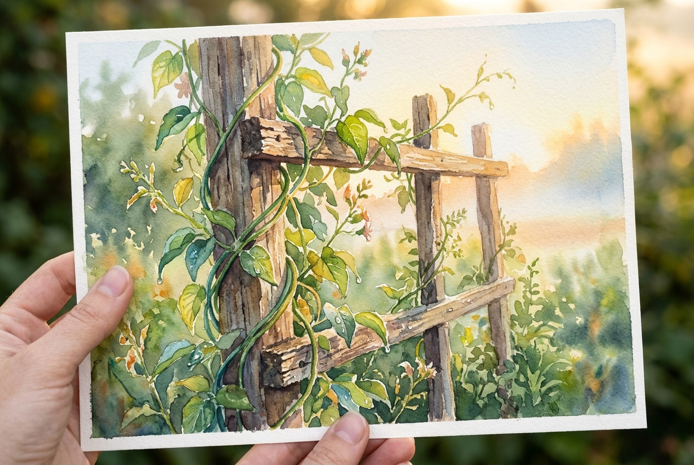

# Leitura Diária: John 15:1-11

*21 de novembro de 2026*

> *(Image: A close-up view of a vibrant green vine winding around a rustic wooden trellis, bathed in the warm, golden light of early morning.)*

## A Leitura (PT-NVI)

**John 15:1-11**

> 1 "Eu sou a videira verdadeira, e meu Pai é o agricultor. 2 Todo ramo que, estando em mim, não dá fruto, ele corta; e todo que dá fruto ele poda, para que dê mais fruto ainda. 3 Vocês já estão limpos, pela palavra que lhes tenho falado. 4 Permaneçam em mim, e eu permanecerei em vocês. Nenhum ramo pode dar fruto por si mesmo, se não permanecer na videira. Vocês também não podem dar fruto, se não permanecerem em mim. 5 "Eu sou a videira; vocês são os ramos. Se alguém permanecer em mim e eu nele, esse dá muito fruto; pois sem mim vocês não podem fazer coisa alguma. 6 Se alguém não permanecer em mim, será como o ramo que é jogado fora e seca. Tais ramos são apanhados, lançados ao fogo e queimados. 7 Se vocês permanecerem em mim, e as minhas palavras permanecerem em vocês, pedirão o que quiserem, e lhes será concedido. 8 Meu Pai é glorificado pelo fato de vocês darem muito fruto; e assim serão meus discípulos. 9 "Como o Pai me amou, assim eu os amei; permaneçam no meu amor. 10 Se vocês obedecerem aos meus mandamentos, permanecerão no meu amor, assim como tenho obedecido aos mandamentos de meu Pai e em seu amor permaneço. 11 Tenho lhes dito estas palavras para que a minha alegria esteja em vocês e a alegria de vocês seja completa.

## A História

Jesus continua a falar com seus amigos mais próximos durante a última refeição juntos, oferecendo uma imagem poderosa de conexão para ancorá-los na tempestade que se aproxima. Ele se descreve como uma videira e seus seguidores como os ramos, com Deus agindo como o agricultor cuidadoso. No antigo mundo mediterrâneo, os vinhedos exigiam atenção constante e meticulosa para prosperar. O agricultor cortava a madeira morta e podava cuidadosamente os ramos saudáveis para que pudessem produzir uma colheita abundante. Jesus usa essa realidade agrícola familiar para ilustrar como a vitalidade espiritual depende inteiramente de permanecer ligado à fonte de vida. Ele garante aos seus amigos que essa conexão profunda e contínua é a única maneira de experimentar alegria verdadeira e propósito duradouro.

## Aplicação para Hoje

Quando enfrentamos estações de transição ou perda, muitas vezes lutamos para encontrar estabilidade através de nossos próprios esforços. No entanto, o convite aqui não é para buscar o controle, mas para manter nossa conexão vital com ele. A poda pode parecer uma redução dolorosa, à medida que hábitos familiares, confortos ou até certos caminhos são retirados. Contudo, esse cuidado atento destina-se a direcionar nossa energia para o que realmente nos sustenta. Ao escolhermos permanecer presentes com Deus através de uma confiança silenciosa, permitimos que sua vida flua em nós naturalmente. Somos libertos da pressão de fabricar nossa própria força e convidados a um espaço de alegria transbordante.

---

*Citações bíblicas extraídas da Nova Versão Internacional (NVI), © 1993, 2000 por Biblica, Inc. Usado com permissão.*
