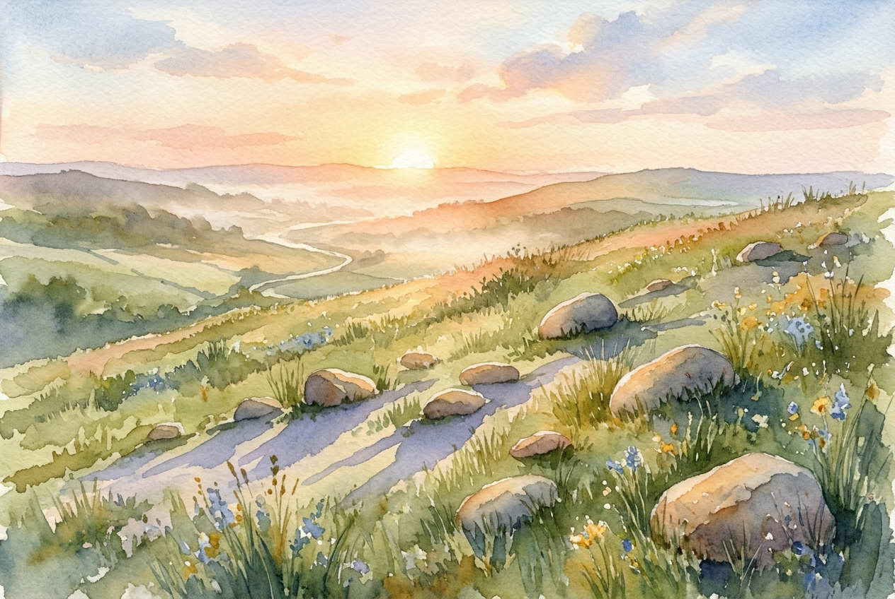

# Daily Reading: Matthew 5:1-12

*November 24, 2026*

> *(Image: A soft sunrise illuminating a quiet, grassy hillside, casting long gentle shadows over a few scattered, smooth stones.)*

## The Reading (NLT)

**Matthew 5:1-12**

> 1 One day as he saw the crowds gathering, Jesus went up on the mountainside and sat down. His disciples gathered around him, 2 and he began to teach them. 3 God blesses those who are poor and realize their need for him, for the Kingdom of Heaven is theirs. 4 God blesses those who mourn, for they will be comforted. 5 God blesses those who are humble, for they will inherit the whole earth. 6 God blesses those who hunger and thirst for justice, for they will be satisfied. 7 God blesses those who are merciful, for they will be shown mercy. 8 God blesses those whose hearts are pure, for they will see God. 9 God blesses those who work for peace, for they will be called the children of God. 10 God blesses those who are persecuted for doing right, for the Kingdom of Heaven is theirs. 11 God blesses you when people mock you and persecute you and lie about you and say all sorts of evil things against you because you are my followers. 12 Be happy about it! Be very glad! For a great reward awaits you in heaven. And remember, the ancient prophets were persecuted in the same way.

## The Story

Jesus steps away from the pressing crowds, climbs a hillside, and takes a seated position, which was the traditional posture of a rabbi ready to give authoritative teaching. His audience is a mix of dedicated followers and curious onlookers looking for a revolutionary leader. What they hear is a radical redefinition of a good life. Instead of praising the wealthy, the powerful, or the comfortable, Jesus elevates those who are often overlooked. He describes a reality where the grieving, the gentle, and the desperate are the ones who truly experience divine favor. This teaching flips the world's value system entirely on its head, offering a kingdom built on vulnerability rather than dominance.

## Application for Today

We live in a society that constantly tells us to hustle for power, hide our grief, and prioritize our own comfort above all else. Yet, this hillside teaching invites us to stop pretending we have it all together. When we acknowledge our deep spiritual need or sit honestly with our sorrow, we are actually stepping right into the presence of God. Being a peacemaker or showing mercy might look like weakness to the culture around us, but it is the very heartbeat of heaven. We do not have to conquer the world to be blessed. We simply need to open our hands, embrace our dependence on grace, and trust that God meets us exactly where we are.

---

*Scripture quotations are taken from the Holy Bible, New Living Translation, copyright © 1996, 2004, 2015 by Tyndale House Foundation. Used by permission of Tyndale House Publishers.*
