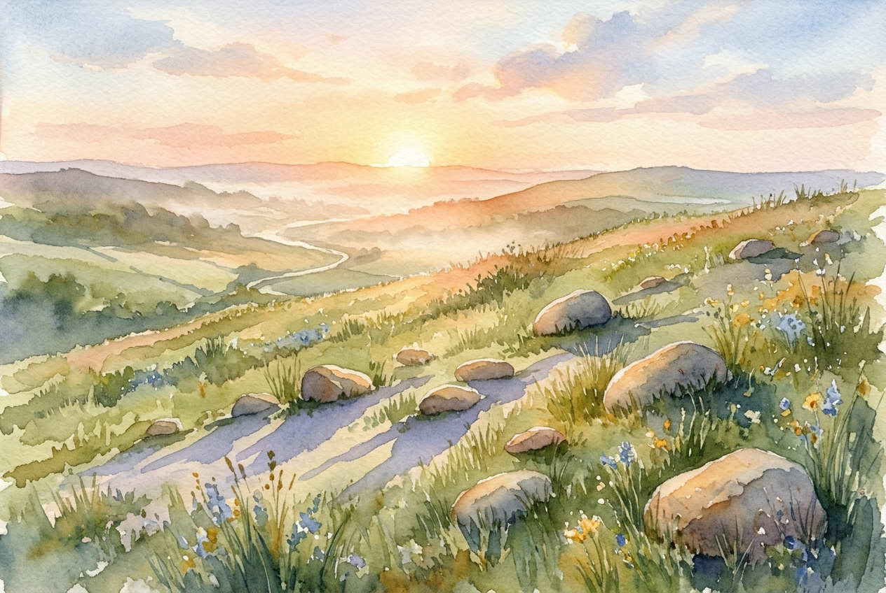

# Leitura Diária: Matthew 5:1-12

*24 de novembro de 2026*

> *(Image: A soft sunrise illuminating a quiet, grassy hillside, casting long gentle shadows over a few scattered, smooth stones.)*

## A Leitura (PT-NVI)

**Matthew 5:1-12**

> 1 Vendo as multidões, Jesus subiu ao monte e se assentou. Seus discípulos aproximaram-se dele, 2 e ele começou a ensiná-los, dizendo: 3 "Bem-aventurados os pobres em espírito, pois deles é o Reino dos céus. 4 Bem-aventurados os que choram, pois serão consolados. 5 Bem-aventurados os humildes, pois eles receberão a terra por herança. 6 Bem-aventurados os que têm fome e sede de justiça, pois serão satisfeitos. 7 Bem-aventurados os misericordiosos, pois obterão misericórdia. 8 Bem-aventurados os puros de coração, pois verão a Deus. 9 Bem-aventurados os pacificadores, pois serão chamados filhos de Deus. 10 Bem-aventurados os perseguidos por causa da justiça, pois deles é o Reino dos céus. 11 "Bem-aventurados serão vocês quando, por minha causa os insultarem, perseguirem e levantarem todo tipo de calúnia contra vocês. 12 Alegrem-se e regozijem-se, porque grande é a recompensa de vocês nos céus, pois da mesma forma perseguiram os profetas que viveram antes de vocês".

## A História

Jesus se afasta das multidões que o pressionavam, sobe a encosta de um monte e senta-se, adotando a postura tradicional de um rabino pronto para transmitir um ensinamento com autoridade. Seu público é uma mistura de seguidores dedicados e curiosos em busca de um líder revolucionário. O que eles ouvem é uma redefinição radical do que significa ter uma vida boa. Em vez de exaltar os ricos, os poderosos ou os que vivem no conforto, Jesus eleva aqueles que são frequentemente ignorados. Ele descreve uma realidade onde os que choram, os mansos e os desesperados são os que verdadeiramente experimentam o favor divino. Esse ensinamento vira o sistema de valores do mundo de cabeça para baixo, oferecendo um reino construído sobre a vulnerabilidade em vez da dominação.

## Aplicação para Hoje

Vivemos em uma sociedade que constantemente nos diz para lutar pelo poder, esconder nossa dor e priorizar nosso próprio conforto acima de tudo. No entanto, este ensinamento na encosta do monte nos convida a parar de fingir que temos tudo sob controle. Quando reconhecemos nossa profunda necessidade espiritual ou lidamos honestamente com nossa tristeza, estamos na verdade entrando diretamente na presença de Deus. Ser um pacificador ou demonstrar misericórdia pode parecer fraqueza para a cultura ao redor, mas é o próprio pulsar do céu. Não precisamos conquistar o mundo para sermos abençoados. Precisamos simplesmente abrir nossas mãos, abraçar nossa dependência da graça e confiar que Deus nos encontra exatamente onde estamos.

---

*Citações bíblicas extraídas da Nova Versão Internacional (NVI), © 1993, 2000 por Biblica, Inc. Usado com permissão.*
