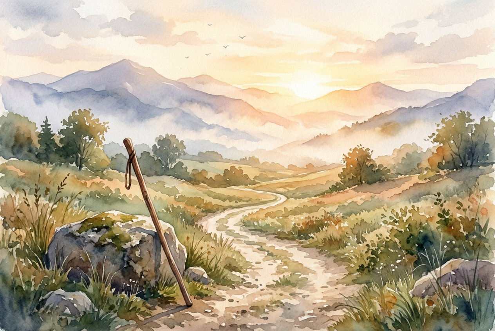

# Daily Reading: Psalm 121

*November 24, 2026*

> *(Image: A winding dirt path leads toward distant, misty mountains under a soft, golden sunrise, with a solitary wooden walking stick resting against a stone in the foreground.)*

## The Reading (NLT)

**Psalm 121**

> 1 I look up to the mountainsdoes my help come from there? 2 My help comes from the Lord, who made heaven and earth! 3 He will not let you stumble; the one who watches over you will not slumber. 4 Indeed, he who watches over Israel never slumbers or sleeps. 5 The Lord himself watches over you! The Lord stands beside you as your protective shade. 6 The sun will not harm you by day, nor the moon at night. 7 The Lord keeps you from all harm and watches over your life. 8 The Lord keeps watch over you as you come and go, both now and forever.

## The Story

The ancient pilgrims who first sang this song were embarking on a long, arduous journey upward toward Jerusalem. As they traveled, the towering landscape around them presented a complex reality. The high places were beautiful, yet they also hid threats like bandits, harsh weather, and shrines to local deities promising false security. The singer asks a vulnerable question about where their ultimate safety lies amidst such daunting surroundings. The answer shifts their gaze beyond the immediate terrain to the architect of the terrain itself. They remind themselves that the maker of the cosmos is intimately attentive to their every step.

## Application for Today

We often face seasons where the path ahead seems steep and intimidating. It is natural to scan our surroundings for a source of stability, looking for anything that might offer a quick sense of security. Yet true assurance does not come from the imposing structures or powers we can see around us. It comes from trusting that the Creator is deeply invested in our daily preservation. This divine guardian does not take breaks, grow fatigued, or lose sight of our struggles. We can walk forward in confidence, knowing that the one who shaped the earth is actively holding our lives.

---

*Scripture quotations are taken from the Holy Bible, New Living Translation, copyright © 1996, 2004, 2015 by Tyndale House Foundation. Used by permission of Tyndale House Publishers.*
