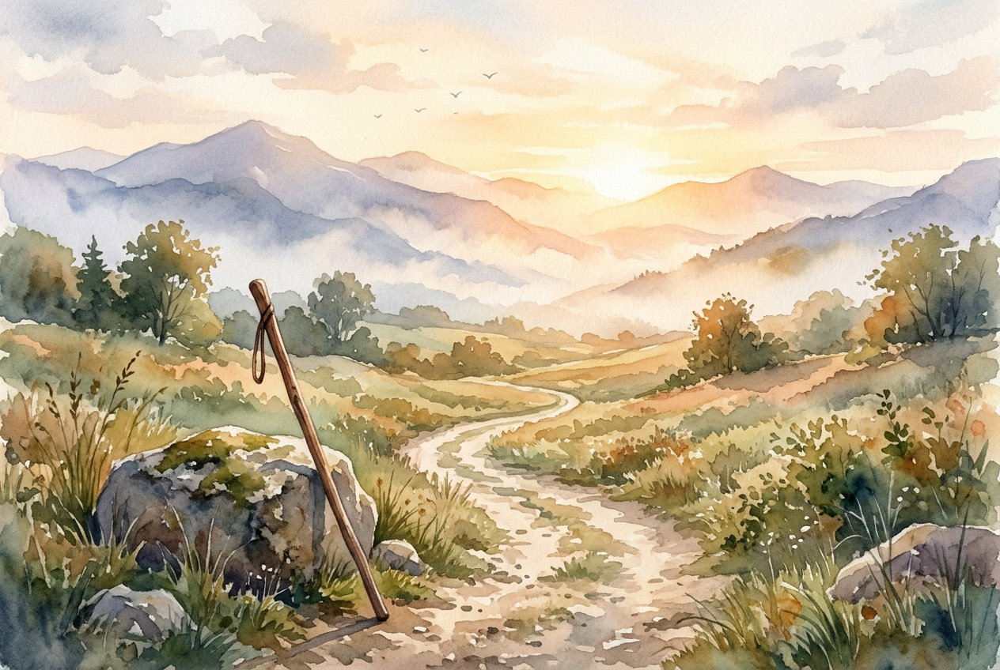

# Leitura Diária: Psalm 121

*24 de novembro de 2026*

> *(Image: A winding dirt path leads toward distant, misty mountains under a soft, golden sunrise, with a solitary wooden walking stick resting against a stone in the foreground.)*

## A Leitura (PT-NVI)

**Psalm 121**

> 1 Levanto os meus olhos para os montes e pergunto: De onde me vem o socorro? 2 O meu socorro vem do Senhor, que fez os céus e a terra. 3 Ele não permitirá que você tropece; o seu protetor se manterá alerta, 4 sim, o protetor de Israel não dormirá, ele está sempre alerta! 5 O Senhor é o seu protetor; como sombra que o protege, ele está à sua direita. 6 De dia o sol não o ferirá, nem a lua, de noite. 7 O Senhor o protegerá de todo o mal, protegerá a sua vida. 8 O Senhor protegerá a sua saída e a sua chegada, desde agora e para sempre.

## A História

Os antigos peregrinos que cantaram este cântico pela primeira vez estavam embarcando em uma longa e árdua viagem rumo a Jerusalém. Enquanto caminhavam, a paisagem imponente ao redor apresentava uma realidade complexa. Os lugares altos eram belos, mas também escondiam ameaças como saqueadores, clima severo e altares de divindades locais que prometiam falsa segurança. O cantor faz uma pergunta vulnerável sobre onde reside sua verdadeira proteção em meio a um ambiente tão intimidador. A resposta desvia o olhar do terreno imediato para o próprio arquiteto desse cenário. Eles lembram a si mesmos de que o criador do cosmos está intimamente atento a cada um de seus passos.

## Aplicação para Hoje

Muitas vezes enfrentamos fases em que o caminho à frente parece íngreme e assustador. É natural observar o nosso entorno em busca de uma fonte de estabilidade, procurando qualquer coisa que possa oferecer uma sensação rápida de segurança. No entanto, a verdadeira garantia não vem das estruturas imponentes ou dos poderes que podemos ver ao nosso redor. Ela nasce da confiança de que o Criador está profundamente comprometido com o nosso cuidado diário. Esse guardião divino não faz pausas, não se cansa, nem perde de vista as nossas lutas. Podemos seguir em frente com confiança, sabendo que aquele que moldou a terra sustenta ativamente as nossas vidas.

---

*Citações bíblicas extraídas da Nova Versão Internacional (NVI), © 1993, 2000 por Biblica, Inc. Usado com permissão.*
