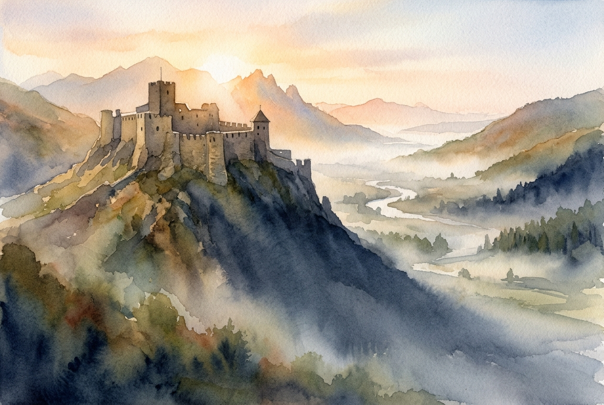

# Daily Reading: Psalm 91

*November 25, 2026*

> *(Image: A heavy stone fortress bathed in soft morning light, with a vast, protective shadow cast across a quiet, misty valley.)*

## The Reading (NLT)

**Psalm 91**

> 1 Those who live in the shelter of the Most High will find rest in the shadow of the Almighty. 2 This I declare about the Lord: He alone is my refuge, my place of safety; he is my God, and I trust him. 3 For he will rescue you from every trap and protect you from deadly disease. 4 He will cover you with his feathers. He will shelter you with his wings. His faithful promises are your armor and protection. 5 Do not be afraid of the terrors of the night, nor the arrow that flies in the day. 6 Do not dread the disease that stalks in darkness, nor the disaster that strikes at midday. 7 Though a thousand fall at your side, though ten thousand are dying around you, these evils will not touch you. 8 Just open your eyes, and see how the wicked are punished. 9 If you make the Lord your refuge, if you make the Most High your shelter, 10 no evil will conquer you; no plague will come near your home. 11 For he will order his angels to protect you wherever you go. 12 They will hold you up with their hands so you won't even hurt your foot on a stone. 13 You will trample upon lions and cobras; you will crush fierce lions and serpents under your feet! 14 The Lord says, I will rescue those who love me. I will protect those who trust in my name. 15 When they call on me, I will answer; I will be with them in trouble. I will rescue and honor them. 16 I will reward them with a long life and give them my salvation.

## The Story

Ancient life was profoundly vulnerable to sudden and inexplicable threats. The psalmist writes to an audience intimately familiar with the terror of nighttime raids, the devastation of sudden plagues, and the lethal danger of wild predators. To capture the scale of divine protection, the poetry shifts rapidly between metaphors. The Creator is described as a fortress, a mother bird shielding her young, and a commander dispatching angels. The imagery covers every conceivable angle of attack, whether from the darkness of night or the glaring light of midday. It is a comprehensive song of trust, designed to be spoken aloud as a declaration of allegiance.

## Application for Today

We no longer worry much about lions or daytime arrows, but the geography of human fear remains largely unchanged. We still lie awake dreading invisible threats, sudden diagnoses, and the chaotic violence of the world. The invitation here is not a guarantee of a trouble-free life, but a promise of ultimate security. When we make the Divine our dwelling place, we shift our center of gravity away from our anxieties. We find a quiet resilience that allows us to face a dangerous world without being consumed by panic. The deepest comfort is the final promise that in our moments of greatest trouble, we are never abandoned.

---

*Scripture quotations are taken from the Holy Bible, New Living Translation, copyright © 1996, 2004, 2015 by Tyndale House Foundation. Used by permission of Tyndale House Publishers.*
