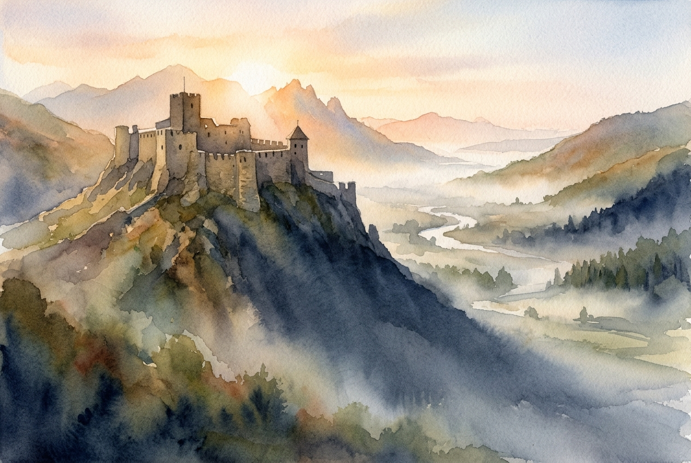

# Leitura Diária: Psalm 91

*25 de novembro de 2026*

> *(Image: A heavy stone fortress bathed in soft morning light, with a vast, protective shadow cast across a quiet, misty valley.)*

## A Leitura (PT-NVI)

**Psalm 91**

> 1 Aquele que habita no abrigo do Altíssimo e descansa à sombra do Todo-poderoso 2 pode dizer ao Senhor: Tu és o meu refúgio e a minha fortaleza, o meu Deus, em quem confio. 3 Ele o livrará do laço do caçador e do veneno mortal. 4 Ele o cobrirá com as suas penas, e sob as suas asas você encontrará refúgio; a fidelidade dele será o seu escudo protetor. 5 Você não temerá o pavor da noite, nem a flecha que voa de dia, 6 nem a peste que se move sorrateira nas trevas, nem a praga que devasta ao meio-dia. 7 Mil poderão cair ao seu lado, dez mil à sua direita, mas nada o atingirá. 8 Você simplesmente olhará, e verá o castigo dos ímpios. 9 Se você fizer do Altíssimo o seu refúgio, 10 nenhum mal o atingirá, desgraça alguma chegará à sua tenda. 11 Porque a seus anjos ele dará ordens a seu respeito, para que o protejam em todos os seus caminhos; 12 com as mãos eles o segurarão, para que você não tropece em alguma pedra. 13 Você pisará o leão e a cobra; pisoteará o leão forte e a serpente. 14 "Porque ele me ama, eu o resgatarei; eu o protegerei, pois conhece o meu nome. 15 Ele clamará a mim, e eu lhe darei resposta, e na adversidade estarei com ele; vou livrá-lo e cobri-lo de honra. 16 Vida longa eu lhe darei, e lhe mostrarei a minha salvação. "

## A História

A vida no mundo antigo era profundamente vulnerável a ameaças repentinas e inexplicáveis. O salmista escreve para um público que conhecia intimamente o terror de ataques noturnos, a devastação de pestes súbitas e o perigo letal de predadores selvagens. Para capturar a magnitude da proteção divina, a poesia alterna rapidamente entre metáforas. O Criador é descrito como uma fortaleza, uma ave protegendo seus filhotes e um comandante enviando anjos. As imagens cobrem todos os ângulos possíveis de ataque, seja na escuridão da noite ou na luz ofuscante do meio-dia. É uma canção abrangente de confiança, desenhada para ser recitada como uma declaração de lealdade.

## Aplicação para Hoje

Já não nos preocupamos tanto com leões ou flechas diurnas, mas a geografia do medo humano permanece praticamente inalterada. Ainda perdemos o sono temendo ameaças invisíveis, diagnósticos repentinos e a violência caótica do mundo. O convite deste texto não é uma garantia de uma vida sem problemas, mas uma promessa de segurança fundamental. Quando fazemos do Divino a nossa morada, mudamos o nosso centro de gravidade para longe das nossas ansiedades. Encontramos uma resiliência silenciosa que nos permite enfrentar um mundo perigoso sem sermos consumidos pelo pânico. O conforto mais profundo é a promessa final de que, nos nossos momentos de maior angústia, nunca estamos abandonados.

---

*Citações bíblicas extraídas da Nova Versão Internacional (NVI), © 1993, 2000 por Biblica, Inc. Usado com permissão.*
