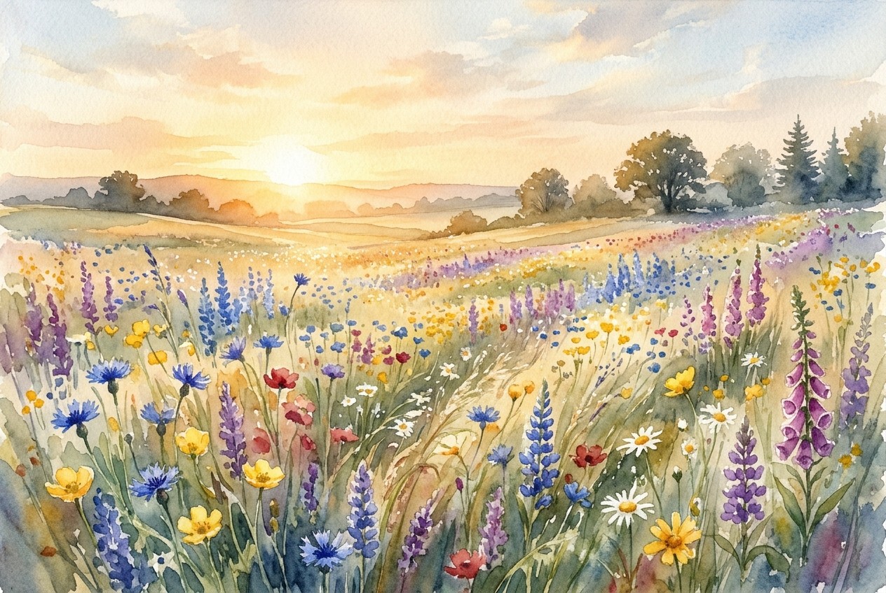

# Leitura Diária: Matthew 6:25-34

*25 de novembro de 2026*

> *(Image: A sprawling field of vibrant wildflowers swaying gently in the morning breeze under a soft golden sunrise.)*

## A Leitura (PT-NVI)

**Matthew 6:25-34**

> 25 "Portanto eu lhes digo: não se preocupem com suas próprias vidas, quanto ao que comer ou beber; nem com seus próprios corpos, quanto ao que vestir. Não é a vida mais importante do que a comida, e o corpo mais importante do que a roupa? 26 Observem as aves do céu: não semeiam nem colhem nem armazenam em celeiros; contudo, o Pai celestial as alimenta. Não têm vocês muito mais valor do que elas? 27 Quem de vocês, por mais que se preocupe, pode acrescentar uma hora que seja à sua vida? 28 "Por que vocês se preocupam com roupas? Vejam como crescem os lírios do campo. Eles não trabalham nem tecem. 29 Contudo, eu lhes digo que nem Salomão, em todo o seu esplendor, vestiu-se como um deles. 30 Se Deus veste assim a erva do campo, que hoje existe e amanhã é lançada ao fogo, não vestirá muito mais a vocês, homens de pequena fé? 31 Portanto, não se preocupem, dizendo: ‘Que vamos comer? ’ ou ‘que vamos beber? ’ ou ‘que vamos vestir? ’ 32 Pois os pagãos é que correm atrás dessas coisas; mas o Pai celestial sabe que vocês precisam delas. 33 Busquem, pois, em primeiro lugar o Reino de Deus e a sua justiça, e todas essas coisas lhes serão acrescentadas. 34 Portanto, não se preocupem com o amanhã, pois o amanhã se preocupará consigo mesmo. Basta a cada dia o seu próprio mal".

## A História

No mundo agrário do primeiro século, a sobrevivência diária estava longe de ser garantida. A maioria das pessoas que ouviam esse ensinamento vivia no limite da subsistência, intimamente familiarizada com a ansiedade de uma colheita perdida ou de um imposto repentino. Eles sabiam muito bem o que era não ter certeza sobre a próxima refeição ou sobre como se aquecer no inverno. Nesse cenário de profunda vulnerabilidade, a natureza é apresentada como uma verdadeira sala de aula. A atenção do povo é desviada das preocupações financeiras para a existência simples e sem pressa das aves e das flores silvestres. O convite não é para ignorar as necessidades físicas reais, mas para reconhecer um universo onde o cuidado divino alcança as partes mais frágeis da criação.

## Aplicação para Hoje

Muitas vezes carregamos o futuro como uma pedra pesada, convencidos de que nossa ansiedade é a única coisa que impede nossas vidas de desmoronar. No entanto, o texto nos lembra que nossa agitação mental não acrescenta absolutamente nada à nossa segurança ou tempo de vida. Confiar na provisão divina não significa abandonar nossas responsabilidades diárias, mas sim mudar nosso centro de gravidade interno. Quando priorizamos os valores do Reino, encontramos um ritmo completamente diferente para os nossos dias. Somos convidados a soltar os problemas fantasmas do amanhã e focar nossa energia na graça disponível no momento presente. O dia de hoje tem desafios suficientes para enfrentarmos, mas também contém cuidado suficiente para nos sustentar.

---

*Citações bíblicas extraídas da Nova Versão Internacional (NVI), © 1993, 2000 por Biblica, Inc. Usado com permissão.*
