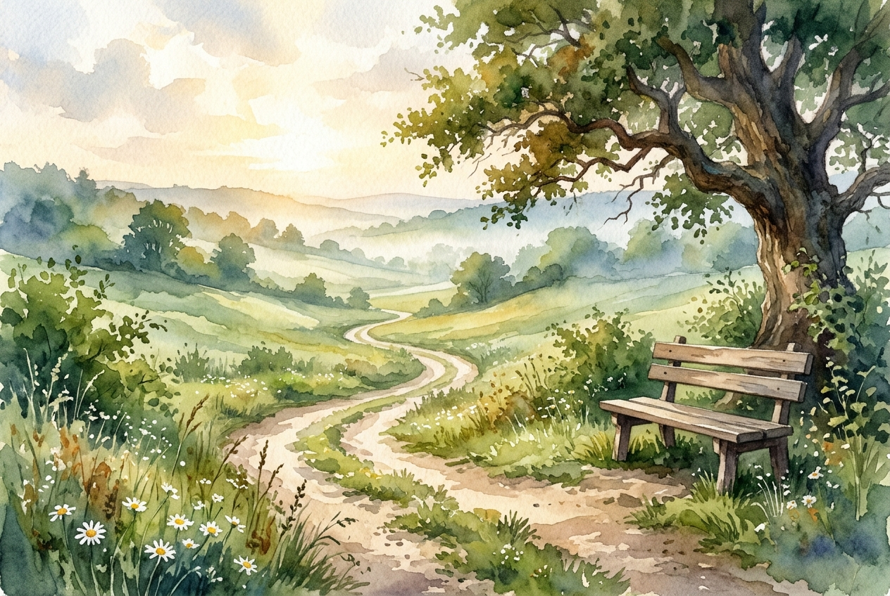

# Daily Reading: Matthew 11:28-30

*November 26, 2026*

> *(Image: A sunlit dirt path winding through a quiet, misty green valley, with a simple wooden bench resting under the shade of an ancient oak tree.)*

## The Reading (NLT)

**Matthew 11:28-30**

> 28 Then Jesus said, Come to me, all of you who are weary and carry heavy burdens, and I will give you rest. 29 Take my yoke upon you. Let me teach you, because I am humble and gentle at heart, and you will find rest for your souls. 30 For my yoke is easy to bear, and the burden I give you is light.

## The Story

In the agrarian world of the first century, a yoke was a heavy wooden beam used to harness two animals together for field work. Religious teachers of the time also used the word as a metaphor for their specific interpretation of the law. For the everyday people listening to this message, the religious demands placed upon them felt like an unbearable weight, turning faith into an exhausting performance. The invitation offered here stands in stark contrast to that crushing system. Instead of adding more rules to their weary shoulders, the teacher offers a harness that actually fits, designed by someone who understands their limits.

## Application for Today

We still carry an exhausting amount of weight today, whether through our own perfectionism, societal pressures, or a distorted view of what God expects from us. We often believe that faith requires us to work harder and carry more on our own. Yet the profound promise in these words is that we are not meant to pull the plow alone. We are invited to step out of our heavy, self-made harnesses and learn an entirely new rhythm of living. True rest does not mean the end of all responsibility, but rather a shared load with a gentle guide. When we let go of our need to manage everything ourselves, we finally find room to breathe.

---

*Scripture quotations are taken from the Holy Bible, New Living Translation, copyright © 1996, 2004, 2015 by Tyndale House Foundation. Used by permission of Tyndale House Publishers.*
