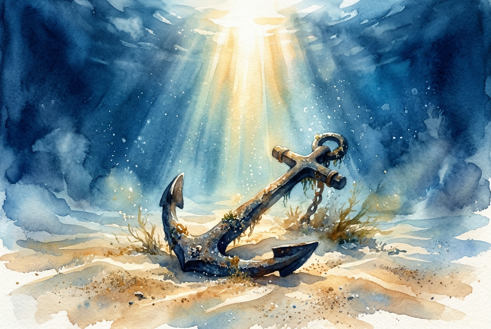

# Daily Reading: Romans 8:31-39

*November 27, 2026*

> *(Image: A heavy iron anchor resting peacefully on a sandy ocean floor, illuminated by a single brilliant shaft of sunlight piercing through the deep blue water.)*

## The Reading (NLT)

**Romans 8:31-39**

> 31 What shall we say about such wonderful things as these? If God is for us, who can ever be against us? 32 Since he did not spare even his own Son but gave him up for us all, won't he also give us everything else? 33 Who dares accuse us whom God has chosen for his own? No one for God himself has given us right standing with himself. 34 Who then will condemn us? No one for Christ Jesus died for us and was raised to life for us, and he is sitting in the place of honor at God's right hand, pleading for us. 35 Can anything ever separate us from Christ's love? Does it mean he no longer loves us if we have trouble or calamity, or are persecuted, or hungry, or destitute, or in danger, or threatened with death? 36 (As the Scriptures say, For your sake we are killed every day; we are being slaughtered like sheep.) 37 No, despite all these things, overwhelming victory is ours through Christ, who loved us. 38 And I am convinced that nothing can ever separate us from God's love. Neither death nor life, neither angels nor demons, neither our fears for today nor our worries about tomorrow not even the powers of hell can separate us from God's love. 39 No power in the sky above or in the earth below indeed, nothing in all creation will ever be able to separate us from the love of God that is revealed in Christ Jesus our Lord.

## The Story

Paul reaches the emotional peak of his letter to the Roman church by dismantling every possible source of spiritual anxiety. The early Christians were intimately familiar with physical danger, social rejection, and the looming threat of the empire. To address their very real fears, the apostle constructs a comprehensive inventory of human suffering and cosmic forces. He methodically addresses both earthly trials and unseen spiritual powers to demonstrate that none possess the authority to sever divine affection. The ultimate proof of this security rests in the historical reality of the cross and the ongoing intercession of the risen Lord. By pointing to what has already been sacrificed, Paul argues that God's commitment to humanity is absolute and irreversible.

## Application for Today

We often measure our spiritual standing by our current circumstances, assuming that hardship signals divine distance or disapproval. When life feels chaotic or painful, it is easy to wonder if we have somehow slipped out of grace. Yet this passage insists that suffering is not a metric for love, nor is it a sign of abandonment. You are held by a grip much stronger than your ability to hold on. Whatever anxieties you carry about the future, or whatever failures haunt your past, they do not have the power to alter your ultimate belonging. Rest in the quiet confidence that the most fundamental truth of your existence is an attachment that cannot be broken.

---

*Scripture quotations are taken from the Holy Bible, New Living Translation, copyright © 1996, 2004, 2015 by Tyndale House Foundation. Used by permission of Tyndale House Publishers.*
