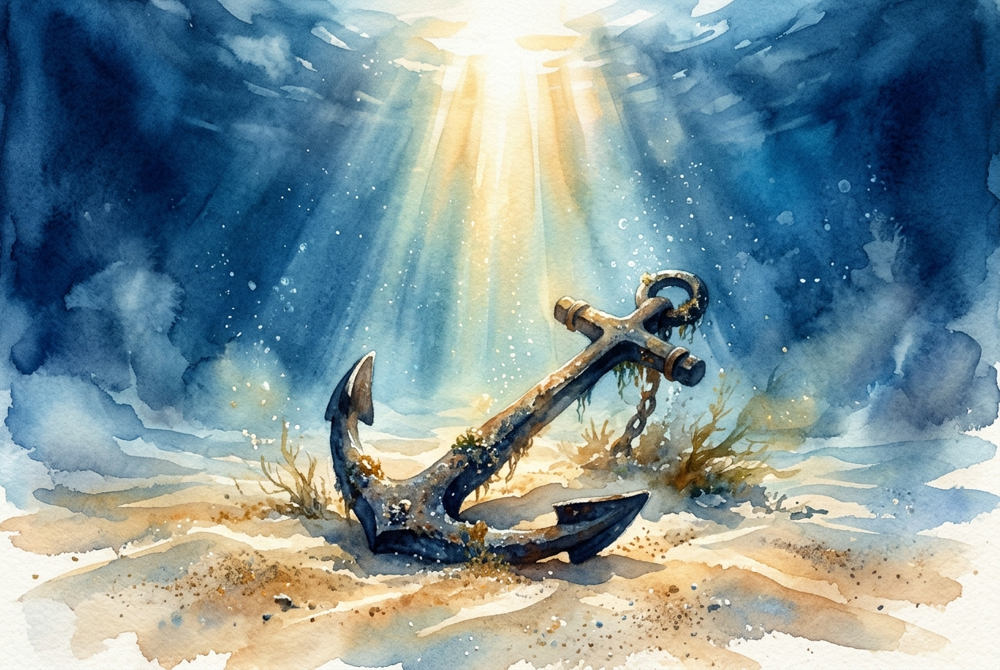

# Leitura Diária: Romans 8:31-39

*27 de novembro de 2026*

> *(Image: A heavy iron anchor resting peacefully on a sandy ocean floor, illuminated by a single brilliant shaft of sunlight piercing through the deep blue water.)*

## A Leitura (PT-NVI)

**Romans 8:31-39**

> 31 Que diremos, pois, diante dessas coisas? Se Deus é por nós, quem será contra nós? 32 Aquele que não poupou a seu próprio Filho, mas o entregou por todos nós, como não nos dará juntamente com ele, e de graça, todas as coisas? 33 Quem fará alguma acusação contra os escolhidos de Deus? É Deus quem os justifica. 34 Quem os condenará? Foi Cristo Jesus que morreu; e mais, que ressuscitou e está à direita de Deus, e também intercede por nós. 35 Quem nos separará do amor de Cristo? Será tribulação, ou angústia, ou perseguição, ou fome, ou nudez, ou perigo, ou espada? 36 Como está escrito: "Por amor de ti enfrentamos a morte todos os dias; somos considerados como ovelhas destinadas ao matadouro". 37 Mas, em todas estas coisas somos mais que vencedores, por meio daquele que nos amou. 38 Pois estou convencido de que nem morte nem vida, nem anjos nem demônios, nem o presente nem o futuro, nem quaisquer poderes, 39 nem altura nem profundidade, nem qualquer outra coisa na criação será capaz de nos separar do amor de Deus que está em Cristo Jesus, nosso Senhor.

## A História

Paulo atinge o ápice emocional de sua carta à igreja romana ao desconstruir todas as fontes possíveis de ansiedade espiritual. Os primeiros cristãos conheciam intimamente o perigo físico, a rejeição social e a ameaça constante do império. Para lidar com esses medos tão reais, o apóstolo elabora um inventário abrangente do sofrimento humano e das forças cósmicas. Ele aborda metodicamente tanto as provações terrenas quanto os poderes espirituais invisíveis para demonstrar que nenhum deles possui autoridade para romper o afeto divino. A prova definitiva dessa segurança reside na realidade histórica da cruz e na intercessão contínua do Senhor ressurreto. Ao apontar para o sacrifício que já foi feito, Paulo argumenta que o compromisso de Deus com a humanidade é absoluto e irreversível.

## Aplicação para Hoje

Muitas vezes medimos nossa condição espiritual pelas circunstâncias atuais, assumindo que as dificuldades indicam distância ou desaprovação divina. Quando a vida parece caótica ou dolorosa, é fácil imaginar se de alguma forma nos afastamos da graça. No entanto, este texto insiste que o sofrimento não é um termômetro para o amor, nem um sinal de abandono. Você é sustentado por uma força muito maior do que a sua própria capacidade de se segurar. Quaisquer que sejam as ansiedades que você carrega sobre o futuro, ou as falhas que assombram o seu passado, elas não têm o poder de alterar o seu pertencimento final. Descanse na confiança serena de que a verdade mais fundamental da sua existência é um vínculo que jamais pode ser quebrado.

---

*Citações bíblicas extraídas da Nova Versão Internacional (NVI), © 1993, 2000 por Biblica, Inc. Usado com permissão.*
