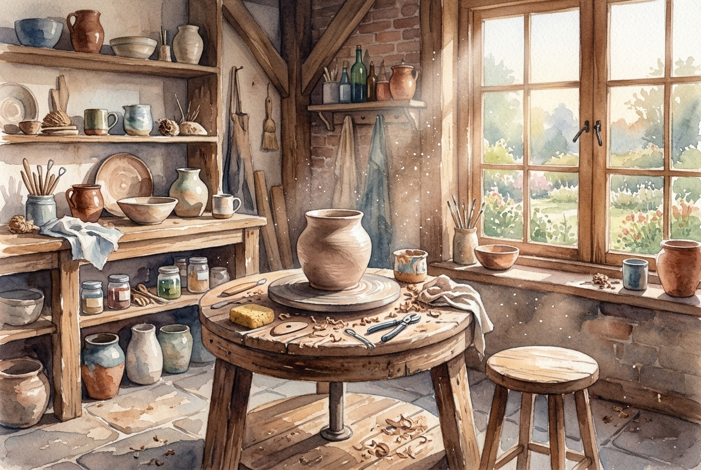

# Daily Reading: Ephesians 2:1-10

*November 27, 2026*

> *(Image: A rustic pottery studio bathed in soft morning light, with a half-formed clay vessel resting on a wooden wheel, surrounded by scattered tools and glowing dust motes.)*

## The Reading (NLT)

**Ephesians 2:1-10**

> 1 Once you were dead because of your disobedience and your many sins. 2 You used to live in sin, just like the rest of the world, obeying the devil the commander of the powers in the unseen world. He is the spirit at work in the hearts of those who refuse to obey God. 3 All of us used to live that way, following the passionate desires and inclinations of our sinful nature. By our very nature we were subject to God's anger, just like everyone else. 4 But God is so rich in mercy, and he loved us so much, 5 that even though we were dead because of our sins, he gave us life when he raised Christ from the dead. (It is only by God's grace that you have been saved!) 6 For he raised us from the dead along with Christ and seated us with him in the heavenly realms because we are united with Christ Jesus. 7 So God can point to us in all future ages as examples of the incredible wealth of his grace and kindness toward us, as shown in all he has done for us who are united with Christ Jesus. 8 God saved you by his grace when you believed. And you can't take credit for this; it is a gift from God. 9 Salvation is not a reward for the good things we have done, so none of us can boast about it. 10 For we are God's masterpiece. He has created us anew in Christ Jesus, so we can do the good things he planned for us long ago.

## The Story

In his letter to the Ephesian church, Paul paints a stark before-and-after picture of the human condition. He describes a past where people were entirely trapped by destructive patterns, cultural currents, and a profound spiritual lifelessness. There was nothing they could do to pull themselves out of this deep well of alienation. Then comes the monumental turning point of the letter, driven entirely by divine mercy rather than human effort. Paul explains that God steps into this lifeless space to breathe new vitality into humanity. This rescue mission is framed not as a transaction, but as a pure, unmerited gift. The result is a total transformation where people are no longer defined by their past failures, but are instead described as divine poetry or a master craftsman's finest work.

## Application for Today

We spend so much of our lives trying to prove our worth through our achievements, moral track records, or sheer exhaustion. This passage dismantles the exhausting treadmill of having to earn our place in the world. Our spiritual vitality and our standing are completely given to us as a gift of grace, removing any ground for pride or anxiety about measuring up. Because we are already loved and rescued, we are free to stop striving for approval. Instead, we are invited to simply walk in the good things that have already been laid out for us. We can view our lives not as a test to pass, but as a canvas where grace is actively at work. Your worth is settled, leaving you completely free to live out the beautiful purpose you were designed for.

---

*Scripture quotations are taken from the Holy Bible, New Living Translation, copyright © 1996, 2004, 2015 by Tyndale House Foundation. Used by permission of Tyndale House Publishers.*
