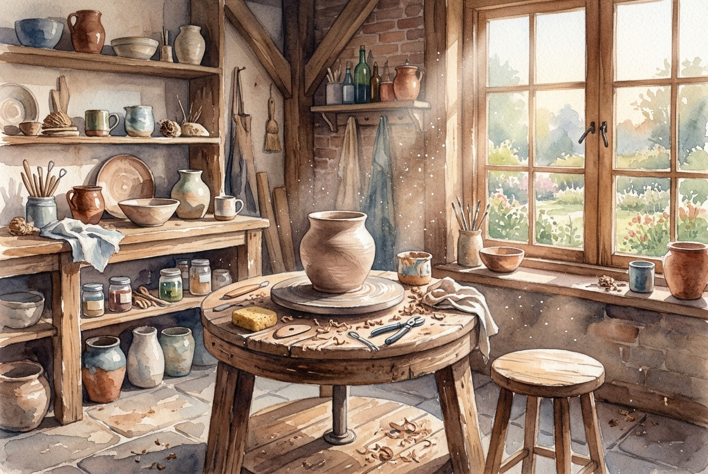

# Leitura Diária: Ephesians 2:1-10

*27 de novembro de 2026*

> *(Image: A rustic pottery studio bathed in soft morning light, with a half-formed clay vessel resting on a wooden wheel, surrounded by scattered tools and glowing dust motes.)*

## A Leitura (PT-NVI)

**Ephesians 2:1-10**

> 1 Vocês estavam mortos em suas transgressões e pecados, 2 nos quais costumavam viver, quando seguiam a presente ordem deste mundo e o príncipe do poder do ar, o espírito que agora está atuando nos que vivem na desobediência. 3 Anteriormente, todos nós também vivíamos entre eles, satisfazendo as vontades da nossa carne, seguindo os seus desejos e pensamentos. Como os outros, éramos por natureza merecedores da ira. 4 Todavia, Deus, que é rico em misericórdia, pelo grande amor com que nos amou, 5 deu-nos vida juntamente com Cristo, quando ainda estávamos mortos em transgressões — pela graça vocês são salvos. 6 Deus nos ressuscitou com Cristo e com ele nos fez assentar nos lugares celestiais em Cristo Jesus, 7 para mostrar, nas eras que hão de vir, a incomparável riqueza de sua graça, demonstrada em sua bondade para conosco em Cristo Jesus. 8 Pois vocês são salvos pela graça, por meio da fé, e isto não vem de vocês, é dom de Deus; 9 não por obras, para que ninguém se glorie. 10 Porque somos criação de Deus realizada em Cristo Jesus para fazermos boas obras, as quais Deus preparou de antemão para que nós as praticássemos.

## A História

Em sua carta à igreja de Éfeso, Paulo pinta um quadro nítido do antes e depois da condição humana. Ele descreve um passado em que as pessoas estavam inteiramente presas a padrões destrutivos, correntes culturais e uma profunda apatia espiritual. Não havia nada que pudessem fazer para se tirar daquele poço fundo de alienação. Então surge o monumental ponto de virada da carta, impulsionado inteiramente pela misericórdia divina, e não pelo esforço humano. Paulo explica que o Criador intervém nesse espaço sem vida para soprar uma nova vitalidade na humanidade. Essa missão de resgate não é apresentada como uma transação, mas como um presente puro e imerecido. O resultado é uma transformação total, onde as pessoas não são mais definidas por suas falhas do passado, mas descritas como a poesia divina ou a obra mais refinada de um mestre artesão.

## Aplicação para Hoje

Passamos grande parte de nossas vidas tentando provar nosso valor por meio de conquistas, histórico moral ou pura exaustão. Esta passagem desmonta a cansativa esteira de ter que fazer por merecer nosso lugar no mundo. Nossa vitalidade espiritual e nossa posição nos são dadas inteiramente como um presente da graça, removendo qualquer base para o orgulho ou para a ansiedade de não sermos bons o suficiente. Como já somos amados e resgatados, temos a liberdade de parar de lutar por aprovação. Em vez disso, somos convidados a simplesmente caminhar nas coisas boas que já foram preparadas para nós. Podemos ver nossas vidas não como um teste a ser superado, mas como uma tela onde a graça está ativamente em ação. Seu valor já está garantido, deixando você completamente livre para viver o belo propósito para o qual foi desenhado.

---

*Citações bíblicas extraídas da Nova Versão Internacional (NVI), © 1993, 2000 por Biblica, Inc. Usado com permissão.*
