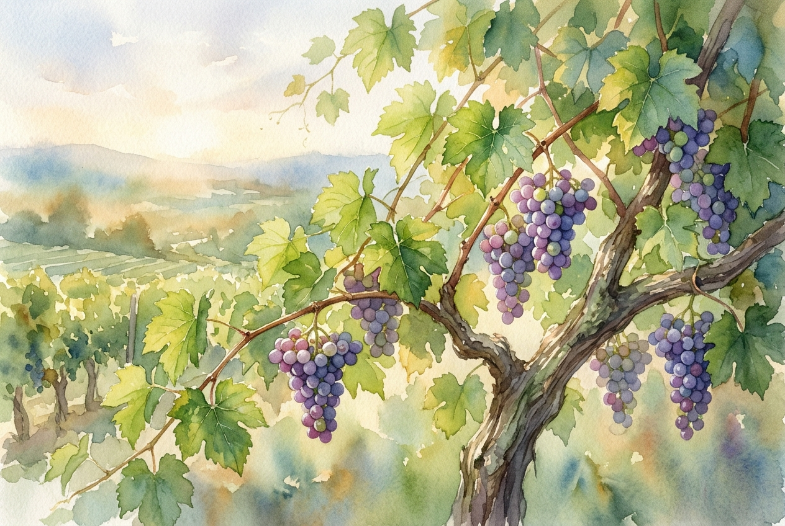

# Daily Reading: John 15:1-11

*November 28, 2026*

> *(Image: A close up view of a flourishing grape vine in a sunlit vineyard, with gentle morning light filtering through vibrant green leaves and sturdy branches.)*

## The Reading (NLT)

**John 15:1-11**

> 1 I am the true grapevine, and my Father is the gardener. 2 He cuts off every branch of mine that doesn't produce fruit, and he prunes the branches that do bear fruit so they will produce even more. 3 You have already been pruned and purified by the message I have given you. 4 Remain in me, and I will remain in you. For a branch cannot produce fruit if it is severed from the vine, and you cannot be fruitful unless you remain in me. 5 Yes, I am the vine; you are the branches. Those who remain in me, and I in them, will produce much fruit. For apart from me you can do nothing. 6 Anyone who does not remain in me is thrown away like a useless branch and withers. Such branches are gathered into a pile to be burned. 7 But if you remain in me and my words remain in you, you may ask for anything you want, and it will be granted! 8 When you produce much fruit, you are my true disciples. This brings great glory to my Father. 9 I have loved you even as the Father has loved me. Remain in my love. 10 When you obey my commandments, you remain in my love, just as I obey my Father's commandments and remain in his love. 11 I have told you these things so that you will be filled with my joy. Yes, your joy will overflow!

## The Story

During his final hours with his closest friends, Jesus uses a familiar agricultural image to explain how they will survive the difficult days ahead. In ancient Judea, vineyards were everywhere, and the vine was a rich historical symbol for the people of Israel. As they walk through the evening, Jesus points to this deeply rooted cultural image and reframes it around himself. He describes an organic, living connection where he is the main vine and his followers are the branches. In this agrarian metaphor, the gardener's pruning is not a punishment but a careful, necessary process to ensure a healthy harvest. The entire ecosystem relies on the branches staying firmly attached to their source of life.

## Application for Today

We often measure our lives by how much we can produce on our own. Our culture celebrates independence, hustle, and self-reliance, making the idea of total dependence feel uncomfortable. Yet this passage invites us to shift our focus from frantic production to quiet connection. The spiritual life is not about straining to generate results, but about staying deeply rooted in divine love. When we experience the sharp pain of pruning, losing a role or an assumption we thought we needed, we can trust that the gardener is making room for new growth. Our only real task is to remain attached to the source, allowing joy and love to flow through us naturally.

---

*Scripture quotations are taken from the Holy Bible, New Living Translation, copyright © 1996, 2004, 2015 by Tyndale House Foundation. Used by permission of Tyndale House Publishers.*
