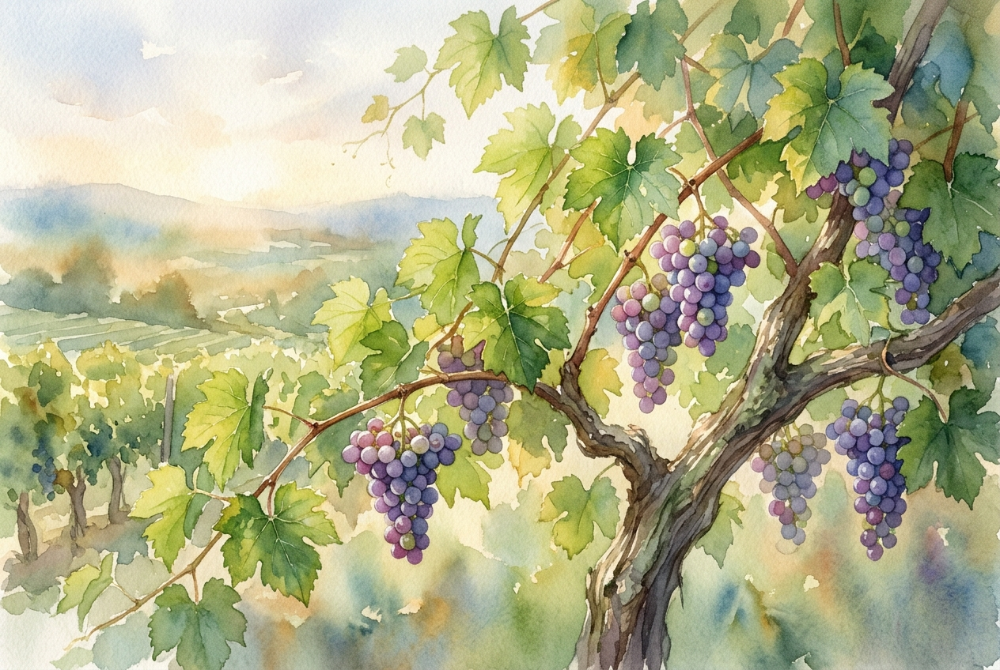

# Leitura Diária: John 15:1-11

*28 de novembro de 2026*

> *(Image: A close up view of a flourishing grape vine in a sunlit vineyard, with gentle morning light filtering through vibrant green leaves and sturdy branches.)*

## A Leitura (PT-NVI)

**John 15:1-11**

> 1 "Eu sou a videira verdadeira, e meu Pai é o agricultor. 2 Todo ramo que, estando em mim, não dá fruto, ele corta; e todo que dá fruto ele poda, para que dê mais fruto ainda. 3 Vocês já estão limpos, pela palavra que lhes tenho falado. 4 Permaneçam em mim, e eu permanecerei em vocês. Nenhum ramo pode dar fruto por si mesmo, se não permanecer na videira. Vocês também não podem dar fruto, se não permanecerem em mim. 5 "Eu sou a videira; vocês são os ramos. Se alguém permanecer em mim e eu nele, esse dá muito fruto; pois sem mim vocês não podem fazer coisa alguma. 6 Se alguém não permanecer em mim, será como o ramo que é jogado fora e seca. Tais ramos são apanhados, lançados ao fogo e queimados. 7 Se vocês permanecerem em mim, e as minhas palavras permanecerem em vocês, pedirão o que quiserem, e lhes será concedido. 8 Meu Pai é glorificado pelo fato de vocês darem muito fruto; e assim serão meus discípulos. 9 "Como o Pai me amou, assim eu os amei; permaneçam no meu amor. 10 Se vocês obedecerem aos meus mandamentos, permanecerão no meu amor, assim como tenho obedecido aos mandamentos de meu Pai e em seu amor permaneço. 11 Tenho lhes dito estas palavras para que a minha alegria esteja em vocês e a alegria de vocês seja completa.

## A História

Durante suas últimas horas com seus amigos mais próximos, Jesus usa uma imagem agrícola familiar para explicar como eles sobreviveriam aos dias difíceis que viriam. Na antiga Judeia, os vinhedos estavam por toda parte, e a videira era um rico símbolo histórico para o povo de Israel. Enquanto caminham pela noite, Jesus aponta para essa imagem cultural profundamente enraizada e a redefine em torno de si mesmo. Ele descreve uma conexão orgânica e viva, onde ele é o tronco principal e seus seguidores são os ramos. Nessa metáfora agrária, a poda feita pelo agricultor não é um castigo, mas um processo cuidadoso e necessário para garantir uma colheita saudável. Todo o ecossistema depende de que os ramos permaneçam firmemente ligados à sua fonte de vida.

## Aplicação para Hoje

Muitas vezes medimos nossas vidas pelo quanto conseguimos produzir por conta própria. Nossa cultura celebra a independência, a pressa e a autossuficiência, fazendo com que a ideia de dependência total pareça desconfortável. No entanto, esta passagem nos convida a mudar nosso foco da produção frenética para uma conexão silenciosa. A vida espiritual não consiste em se esforçar para gerar resultados, mas em permanecer profundamente enraizado no amor divino. Quando experimentamos a dor aguda da poda, perdendo uma posição ou uma certeza que achávamos necessária, podemos confiar que o agricultor está abrindo espaço para um novo crescimento. Nossa única tarefa real é permanecer unidos à fonte, permitindo que a alegria e o amor fluam através de nós naturalmente.

---

*Citações bíblicas extraídas da Nova Versão Internacional (NVI), © 1993, 2000 por Biblica, Inc. Usado com permissão.*
